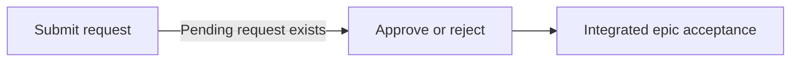

# Vertical slicing and consolidation

A ticket delivers an observable result that advances the approved epic. It may cross all necessary technical layers. A ticket is not a checklist item for a layer. Test and document the behaviour in the same slice.

## Example: purchase request approval

Assume the approved epic permits an authorized user to submit a request and an assigned approver to approve or reject it. This is an illustrative decomposition, not a universal ticket count.

| Excessive horizontal decomposition | Problem |
|---|---|
| Create database schema | No user behaviour by itself |
| Create repository | Requires further work to demonstrate value |
| Create domain entity | Technical building block |
| Create application service | Technical building block |
| Create API endpoint | Incomplete consumer path if required UI is absent |
| Create UI | Depends on the other layers |
| Write integration tests | Feedback arrives late |
| Write documentation | Can drift from implementation |

Prefer two cohesive slices if the risk and complexity permit:

| Slice | Demonstration | Includes | Dependency |
|---|---|---|---|
| Submit a purchase request | A user submits a valid request and can retrieve its pending state. Invalid input is rejected. | Necessary domain, persistence, API/UI, tests and documentation | None or approved executable foundation |
| Approve or reject a pending request | The assigned approver records one terminal decision. Unauthorized or conflicting decisions do not change the request. | Necessary domain, persistence, API/UI, tests, documentation and property verification if required | Submit slice |

The first slice is the thinnest real end-to-end path when feasible. An approved disposable stub can demonstrate wiring, but is not acceptance of production behaviour. Do not delay required security or consistency controls beyond a usable boundary. If decision concurrency requires a risky migration, or the two decision paths are independently complex, separate them with an explicit rationale and observable evidence. A necessary enabling issue (for example, an expand-contract migration) must have an engineering result that can be independently verified.

## Consolidation questions

For each boundary, establish the demonstrable result, acceptance evidence, dependency, and cost of separating or combining the work. Merge dependent technical tasks when neither has useful independent evidence. Split only to reduce material risk, uncertainty or review effort, or deliver a genuinely separate result. Do not use a fixed line count, file count or number of tickets. Draft the minimum authorized batch. Revisit later details when earlier evidence arrives.
