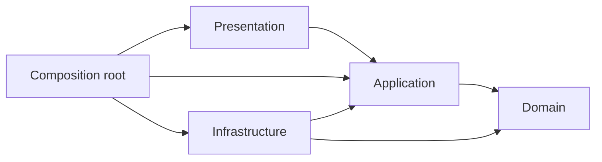

# Onion Architecture, CQRS and boundaries

## Dependency direction

Use the Onion Architecture dependency rule for the application core. Inner layers own contracts. Outer layers depend on and implement those contracts. Runtime calls to adapters may travel outward through the contract without creating an outward source-code dependency.



Arrows indicate source dependencies. The domain depends only on stable domain concepts and necessary language facilities. An application may consume domain interfaces and declare its own ports. Presentation translates transport input/output and invokes application operations. Infrastructure implements IO and framework integration. The composition root constructs the concrete object graph. Do not let the domain import ORM, HTTP, DI container, application handler or cloud SDK. Do not make application logic depend on concrete adapters. Do not let presentation bypass the application to write protected state.

Use explicit constructor injection by default. Keep service-location and global dependency registries out of the core. Framework injection may assemble dependencies at the outer boundary. Manage resource lifecycle explicitly. A pure class does not need injection or an interface solely to satisfy a pattern.

## Contracts and protocols

Define the smallest interface the consumer needs. Use structural protocols where the language supports them, or explicit interfaces otherwise. Define error behavior, null/absence semantics, concurrency and ownership where material. Use an abstract base only when nominal inheritance or shared implementation is necessary. A protocol defines a dependency contract, not a substitute for validating untrusted data or verifying behavior. Add adapter contract tests for critical guarantees. Do not confuse typing conformance with runtime conformance.

## Command and query responsibilities

- A command represents a requested business action. It may return an operation result or identifier. Define the transaction and failure semantics. Mutations pass through the owner of the business invariant. Avoid generic update operations that bypass the domain.
- A query returns a read model without mutating business state. It may use projections optimized for the consumer and separate read contracts. Operational logging and metrics do not change that responsibility.
- Default to logical separation in the same process and data store. Keep command/query handlers and models separate when their needs differ. Do not mandate a mediator, bus, framework or separate physical store. A small simple CRUD or library operation may not benefit from full CQRS. Record a meaningful design exception rather than invent layers.
- Add asynchronous processing, separate stores, outbox, event sourcing or distributed services only when a requirement justifies their costs. Define consistency, lag, ordering, replay, deduplication and recovery before implementation. Event sourcing is not a prerequisite for CQRS.

## Example execution paths

```text
SubmitPurchaseRequestHandler.execute(command)
  authorize(actor, command)
  repository.load(request_id)
  request.submit()
  repository.save(request, expected_version)
  transaction.commit()
  return SubmissionResult

GetPurchaseRequestHandler.execute(query)
  authorize_read(actor, query)
  read_port.get_view(request_id, actor_scope)
  return PurchaseRequestView
```

This is an illustrative call tree, not an API signature or universal transaction ordering. Derive exact preconditions, failures and concurrency from the approved specification.

## Verification and exceptions

Use architecture import checks where possible. Test provider-consumer compatibility through the declared contract. Verify transaction and failure behavior with real relevant dependencies. An approved external SDK, ORM or framework may impose entry-point or type constraints. Keep that exception narrow, document it in the applicable ADR or existing scoped design, and preserve the specified guarantees. Existing code outside the authorized change is not a mandate to migrate.
