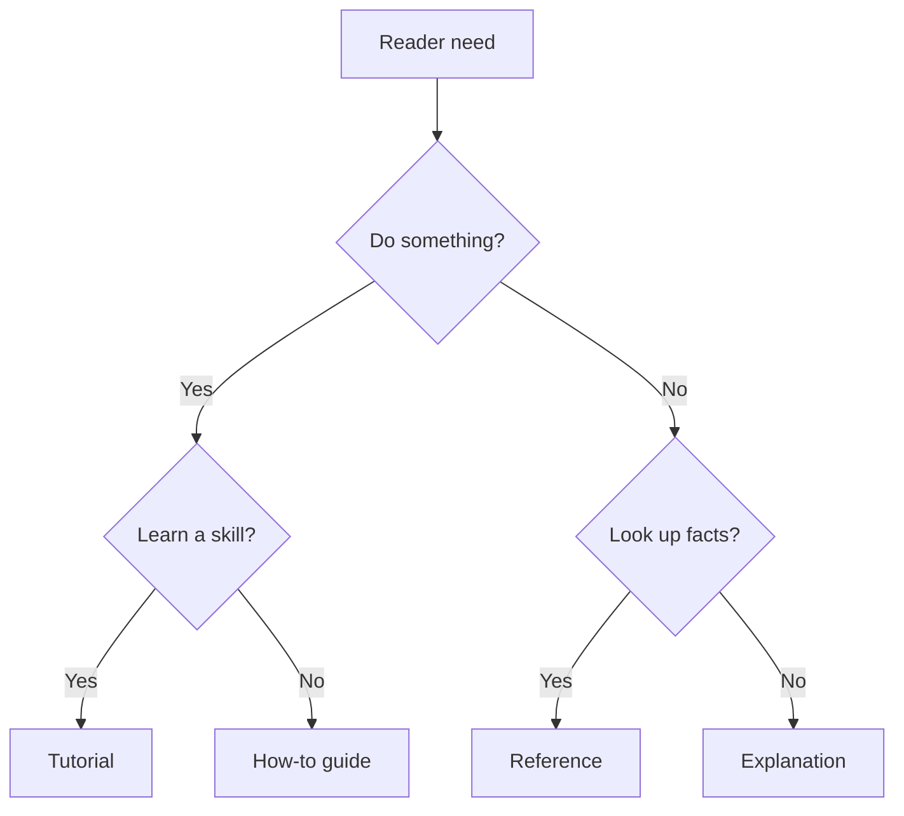

# Documentation formats

Diátaxis organizes reader-facing documentation by need. The directories below are project defaults, not required by Diátaxis. Preserve an existing information architecture unless change is approved. Do not create empty directories or pages to fill a taxonomy.

| Form | Reader need | Default location | Example title |
|---|---|---|---|
| Tutorial | Learn by doing | `docs/tutorials/` | Create your first purchase request |
| How-to guide | Complete a real task | `docs/how-to/` | Retry a failed purchase submission |
| Reference | Look up exact facts | `docs/reference/` | Purchase request API |
| Explanation | Understand why and how | `docs/explanation/` | How purchase decisions remain exclusive |

Internal governance records keep their established formats: `docs/research/`, `docs/requirements/`, root `ARCHITECTURE.md`, `docs/adr/`, `docs/verification/`, `REVIEW.md` and tracker specifications. Link from reader-facing pages, but do not copy the governing record. Use `docs/README.md` as an index when useful. Do not make an index the source of truth for requirements.

## Select a form



## Tutorial template

```markdown
# <Achievable learning outcome>

## What you will learn
<Skill and result, not a catalogue of features.>

## Before you start
<Version, safe environment, minimal prerequisites and sample data.>

## Steps
1. <Perform one action. Show the expected observation.>
2. <Continue the guided path.>

## Result
<What the learner can now do. Verify the expected outcome.>

## Next step
<Link to a related task or explanation.>
```

Example: In a local test project, create one sample request for 100 EUR. Submit it. The response must show `Pending`. Use the actual interface and verified outputs in the project. Keep theory in a linked explanation.

## How-to guide template

```markdown
# <Action to achieve a specific goal>

## Before you start
<Required role, state, tools and important risk.>

## Procedure
1. <Action, condition and observable result.>
2. <Alternative path only when needed.>

## Verify the result
<Command or visible result.>

## Recovery
<Relevant failure handling or reversal. Omit if unnecessary.>
```

Example: If a request submission times out, look up the request by its existing identifier before you submit it again. Verify that only one request exists. This is an illustrative procedure, not an established contract for every application.

## Reference template

```markdown
# <Named interface or component>

## Purpose and scope
<Concise factual description, version and availability.>

## Contract
| Name | Type / input | Meaning / constraint |
|---|---|---|
| <field or operation> | <type> | <rule> |

## Results and errors
<Exact observable results and failure conditions.>

## Example
<Minimal valid input and expected output.>

## Related contracts
<Links to authoritative specifications and source.>
```

Example: document `status` once with permitted values, meaning and transition constraints. Link to the domain rule rather than repeating it across endpoints. Use the actual schema as evidence.

## Explanation template

```markdown
# <Concept or question>

## Summary
<Central answer and scope.>

## How it works
<Mechanism, prerequisites and relationship diagram if useful.>

## Example
<Initial state, action, result and reason.>

## Trade-offs and limits
<Relevant alternatives, conditions and limitations.>

## Related material
<References and procedures.>
```

Example: approval changes `Pending` to a terminal state. A conditional update prevents a concurrent decision from overwriting it if the implemented storage contract provides the stated atomicity. Explain that condition rather than claiming all databases make the operation safe.

## Editorial checks

Use the [writing standard](../../software-factory/references/writing.md). Use tables for lookup and comparison, Mermaid flowcharts for decisions, sequence diagrams for interactions and state diagrams for transitions. Keep a plain-language explanation near each diagram. Preserve actual technical detail. Use concise examples, not invented production behaviour. Run examples, links, diagram checks and STE checks if the repository supports them. Record limitations.
