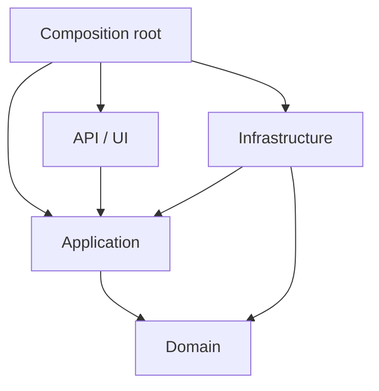

# TypeScript feature architecture

Specialize the [general domain model](../../engineering-standards/references/domain-driven-design.md), [Onion/CQRS rules](../../engineering-standards/references/architecture.md) and [vertical slices](../../engineering-standards/references/code-organization.md). The approved project architecture owns exceptions. The following structure is the default for new TypeScript applications with meaningful feature boundaries; a library or small CRUD capability need not fabricate layers or an aggregate.

## Feature-first layout

```text
src/
  features/
    purchase-requests/
      api/
        purchase-request.controller.ts
        purchase-request.schema.ts
      application/
        commands/
          approve-purchase-request.handler.ts
        queries/
          get-purchase-request.handler.ts
        ports/
          purchase-request.read-port.ts
      domain/
        purchase-request.ts
        purchase-request-id.ts
        purchase-request.repository.ts
      infrastructure/
        adapters/
          postgres/
            database-postgres.ts
            read-adapter-postgres.ts
        repositories/
          purchase-request-repository-postgres.ts
      index.ts
    reporting/
      ...
  shared/                 # only demonstrated shared contracts and primitives
  bootstrap/              # composition, configuration and lifecycle
  app/                    # framework routing, when required by Next.js
```

This is an illustrative layout, not a required file count. A feature groups cohesive domain behavior, not a separate microservice for each endpoint or a new bounded context for each ticket. `api/` means the inbound presentation adapter (HTTP, RPC, CLI or other entry point as applicable). For a UI-bearing feature, use `ui/` for presentation components, hooks and view state where needed; share approved design-system components outside the feature. Keep framework-required routing and entry files at their required locations and delegate inward. Client-only code must not import server-only implementations, secrets or database access. Do not assume a `src/` prefix if the approved project uses another source root.

Apply the general infrastructure roles to TypeScript files. Use kebab-case names that identify the responsibility and concrete backend where useful, such as `repositories/publication-repository-sqlite.ts`, `stores/job-store-sqlite.ts` and `access/github-user-access.ts`. Use provider adapter directories for setup and translation code, such as `adapters/sqlite/database-sqlite.ts` and `adapters/sqlite/read-adapter-sqlite.ts`. [Role-based grouping](../../engineering-standards/references/code-organization.md#role-based-grouping-within-a-feature) · [Feature-owned migrations](../../engineering-standards/references/code-organization.md#feature-owned-migrations)

| Layer | Owns | Permitted dependencies (within the feature) |
|---|---|---|
| Domain | Entities, value objects, aggregate rules, domain services, aggregate repository interfaces | Domain; small framework-independent shared contracts |
| Application | Commands, queries, use cases, read ports, orchestration, transaction coordination | Domain and application contracts |
| API / UI | Transport parsing, request context, routing, presentation, response/error mapping | Application/public contracts, approved presentation dependencies |
| Infrastructure | ORM, databases, SDKs, network adapters, port implementations | Application and domain contracts; external libraries |
| Composition root | Wiring and lifecycle | All relevant layers |



Arrows indicate permitted source dependencies, not runtime call order. A presentation adapter may use explicitly exported domain values if the approved contract requires them, but must not depend on persistence or bypass the application. Apply the same dependency rules to type-only imports. Use explicit public entry points for cross-feature dependencies. Do not expose an entire internal tree through a barrel. Avoid circular imports, private cross-feature imports, global `services`, `models`, `utils` or catch-all `shared` packages. Use stable names from the domain. Do not duplicate another feature's authoritative model. Integrate across contexts through the published contract and map concepts when their meanings differ.

## Object ownership and domain behavior

- Use a class for an entity with identity and lifecycle or a value object that owns construction rules and equality. Protect internal state with private fields, expose only read access or immutable snapshots, and expose domain verbs rather than generic setters. Encapsulate nested mutable values, not just their top-level reference.
- Application handlers own authorization checks, loading, transaction boundaries, use-case coordination and error mapping. The aggregate owns its intrinsic business rules and allowed state transitions. Keep repositories out of entities. An application may load facts or policies necessary for a domain decision and pass them explicitly; do not duplicate the invariant in a controller or handler.
- Use small, consumer-owned interfaces and `implements` for adapters where it improves clarity. TypeScript uses structural typing: `implements` checks compatibility, not behavior. Prefer named interfaces for ports; do not introduce an abstract base class merely to share a signature. Use explicit constructor injection, no hidden service locator or mutable global singleton. Keep framework registration at the composition boundary.
- Place persistence-independent aggregate write contracts in the owning inner layer (domain by default, application where the use case owns the port). Implement persistence in infrastructure. Load and save aggregates using the required atomicity, uniqueness and concurrency guarantees. A rich aggregate alone cannot prevent races between requests. Do not expose ORM entities, vendor query builders or unrestricted generic `update` operations to the domain. Use read-side DTOs/projections and read ports for queries; do not hydrate aggregates only to display a list.
- Show the aggregate load by identity, read-only decision context and atomic write as distinct contracts when the use case needs all three. Name a write port for the effect it commits and define a named input with the guards required by that effect. Follow the [aggregate persistence and transaction rules](../../engineering-standards/references/domain-driven-design.md#persistence-and-consistency).
- Keep command and query responsibilities distinct. A command changes business state and may return an ID/result; a query returns a read model without changing business state. Logical CQRS is sufficient by default. Use real transactions, conditional writes or another approved mechanism when concurrent changes threaten invariants. Add distributed coordination only if the specification requires it.
- Avoid unrelated exported module-level production business functions; put business behavior on meaningful domain objects or cohesive domain services. Static methods and named constructors are valid for stateless behavior with a clear owner. Do not create namespace classes to hide unrelated helper functions. Use pure functions for React components/hooks, callbacks, schemas, tests, framework entry points, functional collection operations, thin adapters and approved library APIs. Keep business behavior out of view rendering and transport code. Do not change public APIs or convert functional UI into classes to satisfy this convention.

## Boundary mappers

Use a focused class named for the models it translates. Keep a stateless mapper's methods static with a private constructor. Give methods directional names such as `toLoadedArchitecture`, `toColumns`, or `toView`. Use named interfaces for structured inputs, explicit return types and TSDoc for the guarantees callers need. Keep storage and provider mappings in the owning feature's `infrastructure/mappers/` when they warrant their own file. [Data Mapper guidance](../../engineering-standards/references/domain-driven-design.md#data-mapper)

Use `unknown` for raw records entering a validation boundary and return an explicit validation result when a record can be invalid. Reuse the boundary schema and call domain constructors or restore methods for domain objects. Map read projections from the records selected by the protected adapter. Preserve context such as workspace, revision or claim identity in the typed inputs and output. Use explicit field assignments so the compiler can check both representations.

In program design, show the input, output, and direction of each material mapper plus its caller in the call flow. Specify round-trip or invalid-input assertions where they protect a meaningful mapping rule.

## Example: approve a purchase request

The following illustrative domain/application shape shows a single independently testable capability. It does not prescribe a persistence or authorization mechanism. The example uses explicit state and immutable results. The repository contract requires an atomic compare-and-save; adapters must independently demonstrate that guarantee. Persistence hydration validates the stored representation and constructs the domain through an approved mapper/factory (not shown). The domain revision in this example is a nonnegative safe integer within the supported storage range.

```ts
type PurchaseRequestId = string & { readonly __brand: "PurchaseRequestId" };
type ApproverId = string & { readonly __brand: "ApproverId" };

type PurchaseRequestState =
  | { readonly kind: "pending" }
  | { readonly kind: "approved"; readonly approvedBy: ApproverId }
  | { readonly kind: "rejected" };

type Approval =
  | { readonly kind: "approved" }
  | { readonly kind: "invalid-state" };

class PurchaseRequest {
  #state: PurchaseRequestState;

  constructor(
    readonly id: PurchaseRequestId,
    initialState: PurchaseRequestState,
  ) {
    this.#state = Object.freeze({ ...initialState });
  }

  get state(): PurchaseRequestState {
    return this.#state;
  }

  approve(approverId: ApproverId): Approval {
    if (this.#state.kind !== "pending") {
      return { kind: "invalid-state" };
    }
    this.#state = Object.freeze({ kind: "approved", approvedBy: approverId });
    return { kind: "approved" };
  }
}

/** Pairs the loaded aggregate with the version expected by its next write. */
interface LoadedPurchaseRequest {
  readonly request: PurchaseRequest;
  readonly version: number;
}

/** Carries the aggregate state and the version that authorizes its replacement. */
interface SavePurchaseRequest {
  readonly request: PurchaseRequest;
  readonly expectedVersion: number;
}

interface PurchaseRequestRepository {
  load(id: PurchaseRequestId): Promise<LoadedPurchaseRequest | undefined>;

  /** Compares the expected version and persists the new state atomically. */
  save(input: SavePurchaseRequest): Promise<"saved" | "conflict">;
}

interface ApprovalAuthorizer {
  canApprove(input: ApprovePurchaseRequest): Promise<boolean>;
}

interface ApprovePurchaseRequest {
  readonly requestId: PurchaseRequestId;
  readonly approverId: ApproverId;
}

type ApprovalResult =
  | Approval
  | { readonly kind: "forbidden" }
  | { readonly kind: "not-found" }
  | { readonly kind: "conflict" };

class ApprovePurchaseRequestHandler {
  constructor(
    private readonly repository: PurchaseRequestRepository,
    private readonly authorizer: ApprovalAuthorizer,
  ) {}

  async execute(command: ApprovePurchaseRequest): Promise<ApprovalResult> {
    if (!(await this.authorizer.canApprove(command))) {
      return { kind: "forbidden" };
    }
    const loaded = await this.repository.load(command.requestId);
    if (loaded === undefined) {
      return { kind: "not-found" };
    }
    const result = loaded.request.approve(command.approverId);
    if (result.kind !== "approved") {
      return result;
    }
    const write = await this.repository.save({
      request: loaded.request,
      expectedVersion: loaded.version,
    });
    return write === "saved" ? result : { kind: "conflict" };
  }
}
```

This example assumes authorization is stable for the operation or enforced by the persistence boundary as required by the approved security model. A changing permission or tenant ownership may require transactional authorization or another approved race-safe check. The handler returns an approved result only after the save succeeds. The mutated aggregate is local to this use case; on a failed save it must not escape or be reused as authoritative state. Test these assumptions, the authorization boundary, invalid transitions, persistence conflicts and recovery with appropriate dependencies.

## Vertical delivery

A slice delivers a coherent behavior through the layers required by that behavior. For purchase requests, prefer “Submit a purchase request” and “Decide a pending request” where independently demonstrable, not separate tickets for the controller, repository, domain object and tests. See [ticket decomposition](../../define-tickets/references/vertical-slicing.md). The approved program design specifies files, signatures, call stack, tests and least-confident decisions. Use interfaces and classes only when they make ownership or behavior clearer.
