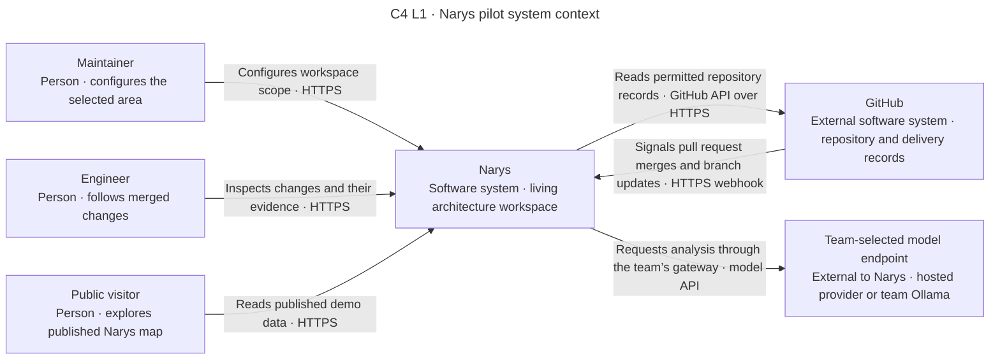
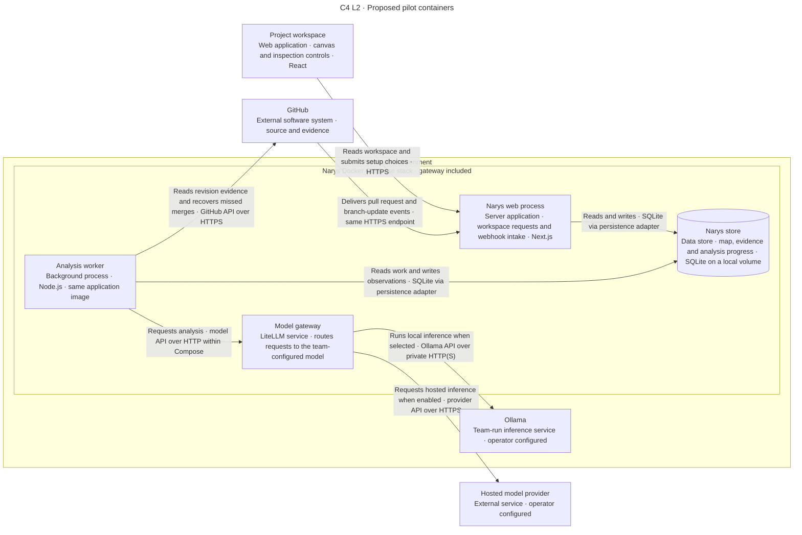

# Narys architecture

## 1. Overview

Status: pre-development architecture draft. The architecture baseline awaits approval. See [decisions and evolution](#8-decisions-and-evolution) for accepted decisions and open proposals.

Specification handoff approval: The product owner approved the original architecture draft as the basis for the V1 specification on November 27, 2026. The reviewed snapshot has SHA-256 `34d1bf2b2481f64b1bf33c80bd20b5d707c79ac2e7a62ca78fbde3fef7f890c9`. ADR-0017 and ADR-0018 record later approved directions. The joint engineering baseline remains pending. [Original reviewed snapshot](docs/approvals/architecture-34d1bf2b2481.snapshot) · [V1 specification draft](SPEC.md)

Narys helps engineers keep up with architectural changes in one selected area of one existing GitHub repository per pilot. It builds the starting map and publishes later merge observations automatically. It shows affected behavior with its source, available rationale, and separately sourced deployment evidence. The Narys dogfood pilot will use the workspace publication setting. [V1 discovery](docs/requirements/product.md) · [Automated map requirement](docs/requirements/v1-automated-map.md) · [Merge coverage](docs/requirements/v1-merge-coverage.md) · [Public demo requirement](docs/requirements/v1-public-narys-demo.md)

## 2. Architecture drivers

| Source | Driver | Design implication |
|---|---|---|
| REQ-001, UX-001, UX-005, [coverage amendment](docs/requirements/v1-merge-coverage.md) | Architecture-changing merges in the selected area trigger an update. Supported change and incomplete evidence can coexist. | Evaluate changes against an identifiable merged revision independently of authorship. Keep unsupported claims distinguishable from observations. Process while the workspace is closed. |
| REQ-002 | Engineers inspect the recorded reason or recognize its absence. | Retain a reference to the rationale record with each displayed explanation. Keep the reason attributable independently of the code observation. |
| REQ-003 | Deployment can be established separately from merge. | Associate deployment evidence with the observed environment and revision. Keep merge processing independent of deployment evidence. |
| REQ-004, UX-008 | A maintainer configures the area and Narys generates a source-backed map. | Run the starting analysis independently of workspace sessions. Keep the source revision and evidence available on the canvas. |
| REQ-005, [public demo release](docs/requirements/v1-public-narys-demo.md) | A visitor can follow the real Narys map and merged changes without signing in. | Keep the public view limited to intentionally published records and preserve signed-in maintenance. |
| UX-003 | The full-screen canvas remains the project surface while engineers inspect recent merges and PR details. | Keep the selected revision, change, and map in one browser workspace. Read the same underlying records in the canvas and its overlays. |

### Applicable engineering standards

Propose the Software Factory general and frontend engineering standards from Narys Git revision `585021a08441aa095cfb8352e48557591b516303`, including their referenced contracts in that revision. Apply them to the web app and worker with repository TypeScript conventions. Use one domain boundary for the living architecture. Keep it independent of the UI and GitHub, SQLite, and model adapters. Separate setup and ingestion commands from workspace reads. Both use the same store. No material exception is proposed. Record adoption in `AGENTS.md` at the joint baseline review. [Engineering standards](.agents/skills/engineering-standards/SKILL.md) · [Frontend engineering](.agents/skills/engineering-standards/references/frontend.md) · [Standards adoption](.agents/skills/software-factory/references/standards.md)

Propose one Node.js runtime version and an npm lockfile. Use the same build and check commands locally and in GitHub Actions. Start with TypeScript checking, lint, and the application build. Add behavior and dependency checks where the first working slice supplies real boundaries and assertions. Use Storybook for the approved React component verification. Select exact versions and commands during repository setup. [Canvas foundation](docs/adr/adr-0015-v1-canvas-foundation.md) · [Locked npm installs](https://docs.npmjs.com/cli/v11/commands/npm-ci/) · [Node.js checks in GitHub Actions](https://docs.github.com/en/actions/tutorials/build-and-test-code/nodejs)

## 3. System context (C4 L1)

The same person may hold both roles. GitHub is the source of record for repository revisions and delivery evidence. Narys owns the map it derives from those revisions. Teams continue to author, merge, and deliver changes through their existing workflows. [ADR-0018](docs/adr/adr-0018-automated-map-publication.md)

## 4. Containers (C4 L2)

| Container | Responsibility | Owns or uses |
|---|---|---|
| Project workspace | Present the map, recent merges, and evidence. Keep the selected revision and overlay state during inspection. | React Flow renders the Narys graph. shadcn/ui provides workspace controls, with Storybook for component verification. The workspace owns browser interaction state and reads architecture and evidence from Narys. [ADR-0015](docs/adr/adr-0015-v1-canvas-foundation.md) |
| Narys web process | Serve the workspace, apply authorized configuration, and record webhook work. | Next.js process. Uses the application rules and server-side access checks. [ADR-0010](docs/adr/adr-0010-v1-application-runtime.md) |
| Analysis worker | Build the starting map and apply supported updates from durable work and source evidence. | Separate Node.js process using the same TypeScript codebase and release image as the web process. [ADR-0010](docs/adr/adr-0010-v1-application-runtime.md) · [ADR-0018](docs/adr/adr-0018-automated-map-publication.md) |
| Narys store | Preserve enough project and processing state for revision comparisons, restarts, and recovery. | Canonical home for the automatically built map, with revision and evidence references. SQLite database on a local volume shared by the web and worker processes. [ADR-0011](docs/adr/adr-0011-v1-persistence.md) · [ADR-0018](docs/adr/adr-0018-automated-map-publication.md) |
| Model gateway | Forward analysis requests to the operator's chosen model route. | File-configured LiteLLM ships in the Compose stack and uses the team's provider credentials and connection settings. Verify hosted and local routing before bundling a release. [ADR-0003](docs/adr/adr-0003-model-gateway-deployment.md) · [ADR-0016](docs/adr/adr-0016-pilot-gateway-product.md) |

## 5. Domain and data architecture

Use the repository and selected area to scope the workspace. Record the initial map with its source revision and keep later revisions available for comparison. An architecture observation concerns a component, responsibility, or relationship at an identifiable revision. Its source, available rationale, and deployment evidence have separate origins and may arrive at different times.

Start assembling the map at a known revision from a file or folder selected by the maintainer or from their plain-language description. Resolve descriptions to candidate starting files and use the same evidence retrieval and map analysis for both routes. Follow directly relevant relationships across directories. Use the map and its source relationships to inform later change analysis. [ADR-0007](docs/adr/adr-0007-starting-map-scope.md) · [ADR-0018](docs/adr/adr-0018-automated-map-publication.md)

The team's Narys installation publishes the first map and subsequent observations through the worker independently of user sessions. The map and recent changes include architecture-changing merges in the selected area from people and agents. Known agent-led changes remain the focus of pilot evaluation. [ADR-0006](docs/adr/adr-0006-merge-coverage.md) · [ADR-0018](docs/adr/adr-0018-automated-map-publication.md)

Narys uses a gateway to analyze selected evidence with a team-run Ollama model or an explicitly configured hosted provider. Narys treats model output as candidate observations and owns the checks against revision-pinned records before it updates the map. The operator chooses the model route. A local route keeps inference within the team's environment, including when a request fails. [ADR-0002](docs/adr/adr-0002-repository-data-boundary.md)

Check concrete claims in PR descriptions, commit messages, and related records against the source before and after integration. Apply the supported source changes to the map. Surface conflicting evidence as a possible divergence and incomplete evidence as unconfirmed. Keep goals such as improved performance as attributed rationale. [ADR-0008](docs/adr/adr-0008-map-update-evidence.md)

### Material interfaces

| Boundary | Provider or owner | Consumer | Contract and compatibility |
|---|---|---|---|
| Repository and delivery records | GitHub | Narys application | GitHub's pull request, repository, and deployment contracts. Use a read-only team-owned GitHub App installation scoped to the pilot repository. Isolate provider payloads in an adapter and check the needed fields and revisions with fixtures. [Pull request API](https://docs.github.com/en/rest/pulls/pulls) · [Deployment statuses API](https://docs.github.com/en/rest/deployments/statuses) · [ADR-0012](docs/adr/adr-0012-github-repository-access.md) |
| Merge signal | GitHub | Narys webhook endpoint | Signed GitHub pull request events. Validate the signature and filter the repository, tracked branch, action, and merged status before accepting work. [Webhook events](https://docs.github.com/en/webhooks/webhook-events-and-payloads#pull_request) · [ADR-0005](docs/adr/adr-0005-merge-detection.md) |
| Branch revision evidence | GitHub | Narys webhook endpoint and reconciliation | Signed target-branch `push` events on the same endpoint as pull request events. Use GitHub commit records to validate the scope and attribution of the transition. [GitHub push event](https://docs.github.com/en/webhooks/webhook-events-and-payloads#push) · [ADR-0009](docs/adr/adr-0009-merged-revision-attribution.md) |
| Workspace reads and setup | Narys application | Project workspace | Better Auth handles GitHub sign-in and sessions. Narys owns server-side role checks for workspace reads and setup. [ADR-0013](docs/adr/adr-0013-workspace-access.md) · [ADR-0018](docs/adr/adr-0018-automated-map-publication.md) |
| Published workspace reads | Narys application | Anonymous visitors | Read-only responses for a deliberately published eligible workspace. Apply eligibility and field selection on the server before serving map or evidence data. [ADR-0017](docs/adr/adr-0017-workspace-publication.md) |
| Architecture analysis | LiteLLM for transport, Narys for analysis requests and observations | Narys worker | Use one interface for text input and candidate observations. Check response shape and evidence references in Narys. Use the same representative fixtures to assess hosted models and Ollama. [ADR-0016](docs/adr/adr-0016-pilot-gateway-product.md) |

## 6. Runtime, deployment, and recovery

The pilot team operates Narys and its bundled gateway with Docker Compose in its own environment. The team connects a hosted account or an Ollama endpoint. The initial design assumes one continuously running host with durable project state. The team configures access, monitors the instance, and handles updates, backup, and recovery. Verify that a container replacement or restore preserves published map revisions and merge progress. [ADR-0001](docs/adr/adr-0001-pilot-operating-model.md) · [ADR-0003](docs/adr/adr-0003-model-gateway-deployment.md) · [Docker Compose deployment](https://docs.docker.com/compose/how-tos/production/)

A GitHub pull request webhook starts processing for merges into the tracked branch. The application validates the signed delivery and stores the work before acknowledging it. Background analysis reads GitHub evidence for the integrated revision and publishes supported observations with evidence gaps. API reconciliation recovers missed merges after interruptions using the same work records. The pilot team supplies HTTPS ingress for the webhook endpoint. Use the team-owned GitHub App for delivery and short-lived installation tokens for API reads. The first dogfood installation connects the Narys repository. Ingress configuration and recovery cadence remain open. [ADR-0005](docs/adr/adr-0005-merge-detection.md) · [ADR-0012](docs/adr/adr-0012-github-repository-access.md)

Use Better Auth for GitHub sign-in and SQLite-backed browser sessions. The application verifies repository eligibility at sign-in and enforces operator-assigned viewer or maintainer access on protected requests. Browser sessions and user authorization stay separate from installation credentials and signed webhook delivery. [ADR-0013](docs/adr/adr-0013-workspace-access.md)

Workspace publication is a standard V1 setting. Every workspace starts private. The operator can enable public reads when the connected repository is public. The same page and workspace data authorization rules apply for the Narys demo and other eligible workspaces. Admit only public evidence to guest responses. The conformance cases cover the default, explicit publication, and withdrawal. [ADR-0017](docs/adr/adr-0017-workspace-publication.md) · [V1 specification](SPEC.md#4-conformance-cases)

The first public product release includes the live, read-only walkthrough of the Narys dogfood map. GitHub reported public visibility for the source repository on November 27, 2026. Verify that the chosen map, merge comparisons, and evidence are eligible for public access before enabling the walkthrough. [Public demo requirement](docs/requirements/v1-public-narys-demo.md) · [ADR-0014](docs/adr/adr-0014-public-narys-demo.md)

For a per-merge explanation, identify the target branch revisions immediately before and after the integration. Record signed target-branch updates and pull request events on the same webhook endpoint. Correlate with GitHub PR and commit evidence before attributing a comparison to one PR. When a verified branch comparison supports a map change and the individual PR remains uncertain, report the supported change with its revision evidence and mark the attribution unconfirmed. [Commit comparison API](https://docs.github.com/en/rest/commits/commits#compare-two-commits) · [ADR-0009](docs/adr/adr-0009-merged-revision-attribution.md)

Use one TypeScript application with a Next.js web process and a Node.js worker process from the same release image. The worker reads durable pending work and keeps analysis outside the webhook request. Keep domain operations shared by the two entry points and transport and storage behind adapters. Run specialized Python tooling in a separate container if a demonstrated need arises. [ADR-0010](docs/adr/adr-0010-v1-application-runtime.md)

Use one SQLite database on a local Compose volume shared by the web and worker. Record webhook work durably before acknowledgement. Commit published map changes and their corresponding work state together. Use a consistent backup and recover later merges through GitHub reconciliation after restore. [ADR-0011](docs/adr/adr-0011-v1-persistence.md)

## 7. Verification and open design work

| Concern | Evidence now | Next verification |
|---|---|---|
| The pilot team can operate and recover the service | Docker documents single-host Compose deployment and persistence across container replacement using volumes. [Compose deployment](https://docs.docker.com/compose/how-tos/production/) · [Volume lifecycle](https://docs.docker.com/engine/storage/volumes/#a-volumes-lifecycle) | Exercise startup, upgrade, and restore on the pilot host. Verify the workspace resumes from its persisted state and catches up with merges that arrived during downtime. |
| Background work can survive an interrupted publication | A local Node.js and SQLite exercise retained committed pending work after process restart. An interrupted transaction rolled back the observation and completion state together. [ADR-0010](docs/adr/adr-0010-v1-application-runtime.md) | Rehearse web and worker process restarts in Compose. Verify work recovery, consistent publication, and receipt of new webhooks during analysis. |
| The web and worker processes can share a recoverable store | A local two-process SQLite exercise read the committed map during a write, observed serialization of a second write, and restored a backup with consistent map and work state. [ADR-0011](docs/adr/adr-0011-v1-persistence.md) | Repeat on the Compose volume with concurrent webhook receipt, workspace setup, and worker publication. Restore in an isolated instance and check reconciliation. |
| A starting map and merge update have a reference answer | Inspection of Flask PR #4692 established the prior JSON response flow, the provider relationship, and the PR rationale. A syntax-tree check corroborated the real delegation claim and found a mismatch with a synthetic wrong-default claim. [Flask reference case](docs/research/2026-11-27-flask-merge-reference-case.md) | Check that Narys finds the provider wiring across directories, shows the mismatch against source, attributes the rationale, and identifies the missing deployment observation. |
| Revision and rationale can be checked independently | A manual sample of Hermes Agent PR #13347 found the shared `NormalizedResponse` type in merge commit `7ab5eebd0365b2cd69daa489f34a05847da65b2a`. The PR records the reason for introducing the shared response shape before generalizing the adapter. [PR #13347](https://github.com/NousResearch/hermes-agent/pull/13347) · [Source at the merged revision](https://github.com/NousResearch/hermes-agent/blob/7ab5eebd0365b2cd69daa489f34a05847da65b2a/agent/transports/types.py#L49-L60) | Exercise architecture derivation on a real area and a short sequence of qualifying changes. Compare claims with a maintainer's reading of the evidence. Measure correction effort, processing time, and gaps. |
| The per-merge explanation isolates the change | In the same manual sample, comparing the PR's reported base to the merge included two CLI files from an intervening commit. The integrated commit's first-parent comparison contained the seven files from the transport change. [Reported-base comparison](https://github.com/NousResearch/hermes-agent/compare/b6b5acfc8e51c9da1537d7896d881eddf7022067...7ab5eebd0365b2cd69daa489f34a05847da65b2a) · [First-parent comparison](https://github.com/NousResearch/hermes-agent/compare/feddb86dbdaaa567d2e31457ea48884359ea4472...7ab5eebd0365b2cd69daa489f34a05847da65b2a) | Verify revision attribution across the merge methods proposed for V1, including a multi-commit rebase, two close merges, and recovery after missed events. A trustworthy overall branch comparison may leave attribution to one PR uncertain. |
| A comparison includes every commit in an integration | A local Git exercise isolated two changes using recorded branch revisions for a merge commit, squash, and rebase. After the rebase, the final commit and its parent exposed only the second change. [ADR-0009](docs/adr/adr-0009-merged-revision-attribution.md) | Verify actual GitHub delivery pairs and recovered associations, including out-of-order deliveries and one branch update containing multiple integrations. |
| Merge freshness survives failures | GitHub documents signed deliveries, delivery identifiers, and consumer recovery of failed deliveries. [Webhook best practices](https://docs.github.com/en/webhooks/using-webhooks/best-practices-for-using-webhooks) · [Failed webhook deliveries](https://docs.github.com/en/webhooks/using-webhooks/handling-failed-webhook-deliveries) | Measure receipt and analysis duration separately. Check invalid signatures, early acknowledgement after durable acceptance, duplicate and delayed deliveries, and recovery after several merges during downtime. |
| Deployment stays attributable | The GitHub API exposes deployment status as a separate record. [Deployment statuses API](https://docs.github.com/en/rest/deployments/statuses) | Verify one environment with a supported revision match and one change with unavailable evidence. |
| Repository access stays within the pilot boundary | GitHub App installation credentials can be scoped to specific repositories and permissions. [GitHub App installation authentication](https://docs.github.com/en/apps/creating-github-apps/authenticating-with-a-github-app/authenticating-as-a-github-app-installation) · [ADR-0012](docs/adr/adr-0012-github-repository-access.md) | Check required evidence reads, both webhook event types, token renewal, and denied writes and out-of-scope private repository access. |
| Workspace setup respects role assignments | GitHub documents user authorization and repository access checks for a GitHub App installation. [GitHub App user authorization](https://docs.github.com/en/apps/creating-github-apps/authenticating-with-a-github-app/generating-a-user-access-token-for-a-github-app) · [ADR-0013](docs/adr/adr-0013-workspace-access.md) | Rehearse sign-in with eligible and ineligible users. Verify viewer and maintainer permissions, setup authorization, and access removal. |
| Public visitors can explore the published map | GitHub confirmed public repository visibility on November 27, 2026. REQ-005 defines the guest walkthrough. [ADR-0014](docs/adr/adr-0014-public-narys-demo.md) | Check public pages, direct requests, and cached responses against public and private evidence fixtures. Verify publication withdrawal and continued authorized workspace access. |
| The canvas supports merge comparison and evidence inspection | The disposable prototype establishes the interaction. React Flow documents viewport controls, accessible graph interactions, and custom nodes. [ADR-0015](docs/adr/adr-0015-v1-canvas-foundation.md) | Exercise stable map positioning, keyboard navigation, overlay focus return, and labeled uncertainty on a rendered retry example. |
| The selected model route preserves its data boundary | LiteLLM documents file-configured deployment, hosted providers, and Ollama. Ollama documents local-only inference. Container and provider route checks are pending. [Gateway decision](docs/adr/adr-0016-pilot-gateway-product.md) · [Ollama local mode](https://docs.ollama.com/faq#how-do-i-disable-ollamas-cloud-features) | Confirm destination and payload with hosted test routes and a team-run Ollama route. Induce a local failure and observe that it cannot send content to a hosted provider. Assess output quality separately. |
| The workspace can build a useful starting map and explain changes | The prototype exercises merge inspection with synthetic evidence. The Flask reference supplies expected source relationships for automated setup. [Prototype observations](EXPERIENCE.md#8-prototypes-and-decisions) · [Flask reference](docs/research/2026-11-27-flask-merge-reference-case.md) | Exercise automated setup and merge updates against real repository evidence. Check the canvas with keyboard and assistive technology, including loading and recovery states. Compare engineer understanding with the team's normal GitHub handoff. |

## 8. Decisions and evolution

| ADR | Decision | Status | Affected area |
|---|---|---|---|
| [ADR-0001](docs/adr/adr-0001-pilot-operating-model.md) | The pilot team self-hosts with Docker Compose. | Accepted | Deployment and operational ownership |
| [ADR-0002](docs/adr/adr-0002-repository-data-boundary.md) | Use a model gateway for team-selected hosted models or Ollama. | Accepted | Model routing and source data boundary |
| [ADR-0003](docs/adr/adr-0003-model-gateway-deployment.md) | Ship the gateway with Narys and let teams connect their own models. | Accepted | Gateway packaging and onboarding |
| [ADR-0004](docs/adr/adr-0004-confirmed-map-ownership.md) | Keep the maintainer-confirmed map in the team's Narys installation. | Superseded | Replaced by ADR-0018 |
| [ADR-0005](docs/adr/adr-0005-merge-detection.md) | Trigger on a GitHub webhook and recover missed merges through API reconciliation. | Accepted | Update trigger, freshness, and recovery |
| [ADR-0006](docs/adr/adr-0006-merge-coverage.md) | Track architecture-changing merges from people and agents in the selected area. | Accepted | Merge coverage and scope |
| [ADR-0007](docs/adr/adr-0007-starting-map-scope.md) | Accept a file or folder selection or a plain-language description for the initial map. | Accepted | Setup, source retrieval, and area scope |
| [ADR-0008](docs/adr/adr-0008-map-update-evidence.md) | Check stated changes against merged source and surface possible divergence. | Accepted | Source correspondence, map updates, and uncertainty |
| [ADR-0009](docs/adr/adr-0009-merged-revision-attribution.md) | Accept pull request and branch-update events on the same webhook. | Accepted | Per-merge comparison and recovery |
| [ADR-0010](docs/adr/adr-0010-v1-application-runtime.md) | Use one TypeScript codebase with Next.js, React, and an analysis worker. | Accepted | Runtime, process boundaries, and packaging |
| [ADR-0011](docs/adr/adr-0011-v1-persistence.md) | Use one SQLite database on a local volume shared by the web and worker processes. | Accepted | Storage, transaction boundaries, and recovery |
| [ADR-0012](docs/adr/adr-0012-github-repository-access.md) | Use a team-owned GitHub App scoped to the pilot repository. | Accepted | Repository permissions, credentials, and webhook configuration |
| [ADR-0013](docs/adr/adr-0013-workspace-access.md) | Use Better Auth for GitHub sign-in and separately grant viewer or maintainer access. | Accepted | Workspace sign-in and permissions |
| [ADR-0014](docs/adr/adr-0014-public-narys-demo.md) | Launch with a live, read-only walkthrough of Narys. | Accepted | Public scope and release timing |
| [ADR-0015](docs/adr/adr-0015-v1-canvas-foundation.md) | Use React Flow for the V1 canvas, with shadcn/ui and Storybook for the React component foundation. | Accepted | Workspace rendering and interaction verification |
| [ADR-0016](docs/adr/adr-0016-pilot-gateway-product.md) | Use file-configured LiteLLM as the bundled V1 gateway, subject to route verification. | Accepted | Model routing, gateway operation, and evidence boundary |
| [ADR-0017](docs/adr/adr-0017-workspace-publication.md) | Start workspaces private and allow opt-in public access for workspaces backed by public GitHub repositories. | Accepted | Workspace visibility, public authorization, and disclosure |
| [ADR-0018](docs/adr/adr-0018-automated-map-publication.md) | Generate the first map and publish later source-backed changes automatically. | Accepted | Map setup, publication, and revision-scoped evidence |

The approved V1 specification defines observable behavior and conformance cases. Review the scoped canvas design through `design-system`, then establish the joint baseline with the applicable engineering standards. Select exact setup versions and pilot ingress settings before configuring deployment. [V1 specification](SPEC.md) · [Visual brief](DESIGN.md)
