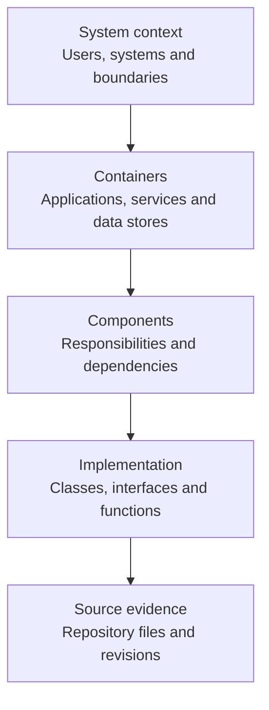
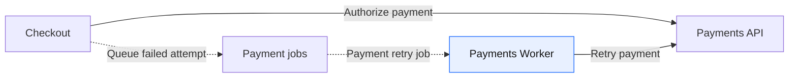
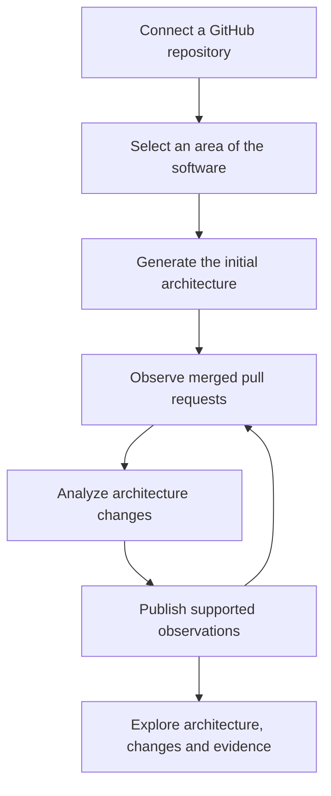
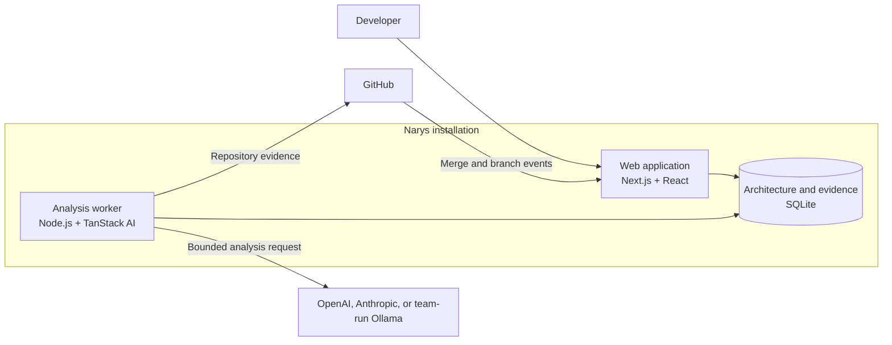

# Narys

**Understand the software your agents build.**

Narys is an open-source architectural intelligence platform designed to reduce cognitive and intent debt in AI-driven software development.

It builds a living representation of your software from repository evidence, follows architectural changes as they merge, and helps you understand what changed, how the system works, and why decisions were made.

Narys is designed for individual developers and engineering teams working with coding agents, whether those agents operate locally, alongside developers, or autonomously in the cloud.

[Product vision](#why-narys) · [How it works](#how-narys-works) · [Getting started](#getting-started) · [Architecture](ARCHITECTURE.md) · [Contributing](#contributing)

> **Development status:** Narys is in active product design and early development. The architectural workspace is available as an interactive Storybook prototype. The first operational release is under development.

## Why Narys?

AI coding agents are changing the economics of software development.

Developers can delegate implementation, run multiple agents in parallel, and deliver increasingly complex software with less manual effort. But the ability to produce software faster does not necessarily mean that humans understand it better.

As agents introduce new components, move responsibilities, change dependencies, and make implementation decisions, the developer's mental model can become increasingly disconnected from the software itself.

This creates two problems.

### Cognitive debt

Cognitive debt is the growing gap between what software actually does and what the people responsible for it understand.

It manifests when:

- Developers struggle to explain how their own software works.
- Architectural changes accumulate faster than documentation can be maintained.
- Engineers repeatedly investigate the same code to recover lost context.
- Teams become uncertain about the consequences of modifying an existing component.
- Agent-generated implementations are merged without a shared understanding of their architectural effects.

### Intent debt

Intent debt accumulates when the goals, constraints, and reasons behind software decisions become missing, stale, or disconnected from the implementation.

Code can explain how something was implemented. It does not always explain why that implementation was chosen.

Important decisions may be distributed across GitHub issues, pull requests, architecture decision records, agent conversations, and informal discussions.

As software evolves, recovering that context becomes increasingly expensive.

### The Narys approach

Narys aims to keep human understanding connected to the software as it changes.

Instead of requiring developers to manually maintain architectural diagrams or repeatedly ask coding agents to explain their codebase, Narys maintains a repository-derived architectural representation with traceable evidence.

**The objective is not to generate more documentation. It is to help developers maintain an accurate, usable mental model of their software.**

## What Narys is building

The Narys experience is organized around four fundamental developer questions.

| Question | Capability |
| --- | --- |
| What have we built? | Explore the current architecture of the software. |
| What has changed? | Inspect architectural changes between repository revisions. |
| How does it work? | Explore components, implementation relationships, and execution flows. |
| Why was it built this way? | Recover recorded rationale, decisions, and supporting evidence. |

These capabilities converge in a single architectural workspace.

### Living architecture

Narys generates an architectural map of a selected repository area and keeps it updated as architectural changes are merged.

The map represents components, responsibilities, interfaces, dependencies, and relevant interactions.

Each published revision remains associated with the repository evidence that supports it.

### Architectural change intelligence

A traditional code diff shows which lines changed.

Narys aims to explain what those changes mean for the architecture.

For example, a pull request might:

- Introduce a new application component.
- Move a responsibility between existing components.
- Change an interface or dependency.
- Introduce an asynchronous processing path.
- Replace an implementation behind an existing abstraction.

Narys identifies supported architectural changes and presents them in the context of the surrounding software.

### Progressive architectural exploration

The architectural explorer is being designed around the principles of the [C4 model](https://c4model.com/).

Developers should be able to move from a high-level understanding of the system towards the implementation details relevant to their current question.



Not every system requires every level of abstraction. The goal is to reveal complexity progressively rather than expose the entire codebase as a single dependency graph.

Detailed architectural drill-down is a proposed V1 experience currently being explored through Storybook.

### Execution flows

Narys is exploring animated architectural flows that help developers understand how software behaves.

An execution flow may illustrate a request moving through an API, a message being consumed by a worker, or data being retrieved from a database.

Animations communicate behaviour supported by the available source evidence. They do not represent live execution unless independently sourced runtime evidence is available.

### Intent and evidence

Architectural observations should be traceable to their source.

Narys connects changes to relevant evidence, including:

- Repository files at identifiable revisions.
- Pull requests and commit records.
- GitHub issues.
- Available architecture decision records and documented rationale.
- Deployment records, when available.

When the available evidence does not establish a claim, Narys makes that uncertainty visible.

## An example

Consider a payment system where the Checkout application initially retries failed payment requests directly.

An agent introduces a change that moves payment retry handling into a background worker.

The resulting architecture might look like this:



Instead of reconstructing the architectural consequences from the entire pull request, a developer should be able to open Narys and understand:

| Observation | Explanation |
| --- | --- |
| Architectural change | Payments Worker now handles queued payment retries. |
| Affected behaviour | Checkout can queue failed payment attempts for background processing. |
| Recorded intent | Move retry processing away from the original request path. |
| Source evidence | Worker registration, retry handler, and queue publication at the merged revision. |
| Unconfirmed behaviour | Whether Checkout can still retry directly. |
| Deployment | Unconfirmed unless independently established. |

The developer can compare the previous and current architecture, inspect the affected components, and follow the evidence back to the source code.

This is a synthetic example used in the Narys design prototypes.

## How Narys works

The planned V1 workflow consists of five steps.



### 1. Connect a repository

A maintainer connects an existing GitHub repository and selects the branch to track.

### 2. Select an area

The maintainer selects a file, folder, or describes the part of the software they want to understand.

Narys follows relevant source relationships beyond the initial selection when necessary.

### 3. Establish the starting architecture

Narys analyzes repository evidence at an identified commit and automatically publishes the starting map.

The developer does not need to construct or maintain the diagram manually.

### 4. Follow architectural changes

When a pull request merges, Narys analyzes the relevant repository changes and evaluates their architectural consequences.

The workspace publishes supported observations and retains earlier revisions for comparison.

### 5. Explore and understand

Developers inspect the architecture, review recent changes, recover recorded rationale, and examine the evidence supporting individual claims.

The analysis continues independently of whether the developer has the workspace open.

## Designed for AI-driven software development

Narys is independent of specific coding-agent providers and development environments.

| Development model | How Narys fits |
| --- | --- |
| Individual developer with a local coding agent | Understand the architecture as delegated changes accumulate. |
| Developer running multiple agents | Recover a coherent view of changes introduced across parallel work. |
| Engineering team using coding agents | Maintain shared architectural understanding across contributors. |
| Autonomous software factory | Inspect architectural consequences as independently executed work is integrated. |
| Conventional software development | Follow architectural changes introduced by human contributors. |

For V1, GitHub is the common integration boundary.

Narys follows architecture-changing merges regardless of whether the work was performed by a person or an agent.

Direct integration with coding-agent sessions and execution environments is a longer-term opportunity, not a prerequisite for the initial product.

## How we represent uncertainty

Software architecture cannot always be established conclusively from repository evidence.

Narys is designed to preserve these distinctions rather than present every generated observation as an established fact.

| Evidence state | Meaning |
| --- | --- |
| Supported by source | Available source evidence supports the architectural claim at an identified revision. |
| Unconfirmed | Available evidence is insufficient to establish the claim. |
| Possible divergence | Repository evidence conflicts with a stated architectural change. |
| Documented intent | A recorded source explains the reason for a decision or change. |
| Missing rationale | The available records do not explain why a change was made. |
| Confirmed deployment | Separate evidence establishes deployment of a relevant revision to an identified environment. |

A merged pull request does not establish deployment.

A source-code relationship does not establish runtime execution.

A documented performance objective does not establish improved performance.

These distinctions are fundamental to the Narys design.

## V1 scope

The initial release focuses on one recurring problem: helping developers keep up with architectural changes as software evolves.

| Capability | V1 scope |
| --- | --- |
| Repository integration | GitHub |
| Analysis scope | One selected area of one repository per pilot |
| Starting architecture | Automatically generated |
| Change detection | Architecture-changing merged pull requests |
| Merge coverage | Human and agent contributions |
| Architectural comparison | Before and after repository revisions |
| Source evidence | Revision-pinned repository references |
| Intent | Existing rationale records and explicit missing-rationale states |
| Deployment | Independently sourced deployment evidence |
| Hosting | Self-hosted |
| Model providers | Team-configured hosted or local models |
| Workspace publication | Opt-in public, read-only access for eligible public repositories |

Progressive architectural navigation, implementation visualization, and illustrative execution flows are being explored as part of the V1 experience design.

The first release does not aim to provide exhaustive repository-wide analysis, live agent monitoring, agent orchestration, runtime observability, or automated architecture enforcement.

Standalone behaviour changes that do not affect the architecture are outside the initial change-tracking scope.

The authoritative release requirements are defined in [SPEC.md](SPEC.md) and its referenced requirements.

## Architecture

Narys is designed as a self-hosted application with a small operational footprint.

The V1 design uses a single TypeScript codebase with separate web and analysis processes and durable local persistence. The analysis worker calls an operator-configured model provider directly through TanStack AI.



| Layer | Planned technology |
| --- | --- |
| Application | TypeScript, Next.js |
| Frontend | React, React Flow, shadcn/ui, TanStack Query for server data, nuqs for URL state |
| Design system | Storybook, Carbon-inspired visual language |
| Background analysis | Node.js |
| Persistence | SQLite, Drizzle ORM, `better-sqlite3`, Drizzle Kit migrations |
| Inference | TanStack AI with direct OpenAI, Anthropic, or local-only Ollama adapters |
| Authentication | Better Auth on Next.js with its Drizzle adapter |
| Validation | Zod at application boundaries |
| Tests | Vitest and Playwright Test |
| Deployment | Docker Compose |

The architecture is deliberately constrained for V1. Additional infrastructure should be introduced only when justified by demonstrated requirements.

See [ARCHITECTURE.md](ARCHITECTURE.md) and the [architecture decision records](docs/adr/) for the system design and its rationale.

## Data ownership and privacy

Narys is designed to operate within the team's own environment.

The planned V1 data boundary includes:

- Repository-scoped, read-only GitHub App access.
- Operator-controlled model selection.
- Support for team-hosted local inference through Ollama.
- No automatic fallback from a configured local inference route to a hosted model.
- Private workspaces by default.
- Explicit authorization for public workspace publication.

Repository evidence is sent to the configured analysis destination. Teams choosing a hosted model provider should consider the provider's data-handling terms.

See [ADR-0021](docs/adr/adr-0021-direct-model-inference.md), [ADR-0012](docs/adr/adr-0012-github-repository-access.md), and [ADR-0017](docs/adr/adr-0017-workspace-publication.md) for the corresponding design decisions.

## Getting started

Narys is currently in early development. A production installation workflow is not yet available.

The current interactive design prototype can be explored locally through Storybook.

### Prerequisites

- Git
- Node.js compatible with the prototype's dependencies
- npm

### Run the design prototype

```bash
git clone https://github.com/matejpalenik/narys.git
cd narys

npm --prefix docs/design/prototypes/canvas-storybook ci

npm --prefix docs/design/prototypes/canvas-storybook run storybook
```

Open [http://localhost:6006](http://localhost:6006) in your browser.

The prototype uses synthetic architectural examples to demonstrate:

- Architectural overview and component inspection.
- Before-and-after pull request comparisons.
- Source evidence and rationale inspection.
- Architectural illustrations and motion.
- Visual notation and graph density.

### Verify the prototype

```bash
npm --prefix docs/design/prototypes/canvas-storybook run typecheck

npm --prefix docs/design/prototypes/canvas-storybook run build-storybook
```

Storybook demonstrates the proposed user experience. It does not yet provide production repository analysis or automatic architecture updates.

## Building Narys in public

Narys is intended to be its own first real-world use case.

The first operational release will include a public, read-only workspace showing the architecture of Narys itself and how it changes as pull requests merge.

This allows developers to explore the product using real repository evidence and observe how its architecture evolves during development.

The objective is to demonstrate Narys through actual use rather than rely exclusively on curated demonstration data.

## Roadmap

### Current: Product design and validation

- Define the product requirements and architectural baseline.
- Establish the visual language and canvas interaction model.
- Prototype architectural change review.
- Explore progressive architectural navigation.
- Establish real repository reference cases.

### V1: Living architecture

- GitHub repository integration.
- Automatic starting-map generation.
- Architecture-changing merge detection and analysis.
- Revision comparisons and evidence inspection.
- Recorded rationale and uncertainty.
- Separate deployment evidence.
- Self-hosted installation.
- Public Narys dogfood workspace.

### Beyond V1

Potential future directions include:

- Broader repository and system coverage.
- Deeper implementation and dependency exploration.
- Integration with coding-agent execution traces.
- Live software factory activity.
- Conversational architecture exploration.
- Intent capture during agent-led development.
- Architectural drift detection.

Future capabilities will be informed by the results of the initial pilot.

## How we measure success

Narys should be evaluated by its effect on developer understanding, not the number of diagrams it generates.

The initial product evaluation will compare Narys with an engineer's normal GitHub review and handoff workflow.

We want to understand whether developers can:

- Explain an architectural change more quickly.
- Correctly identify affected responsibilities and relationships.
- Predict relevant consequences of subsequent changes.
- Recover recorded rationale.
- Recognize gaps in the available evidence.
- Maintain their understanding without manually updating architectural documentation.

These outcomes are product hypotheses to validate through real use.

## Documentation

The repository maintains separate records for product requirements, experience design, architecture, and normative behaviour.

| Document | Purpose |
| --- | --- |
| [Product requirements](docs/requirements/product.md) | Product objectives, users, and initial scope |
| [EXPERIENCE.md](EXPERIENCE.md) | User journeys and interaction design |
| [DESIGN.md](DESIGN.md) | Visual language and design-system decisions |
| [ARCHITECTURE.md](ARCHITECTURE.md) | System architecture and technical decisions |
| [SPEC.md](SPEC.md) | Normative V1 behaviour and conformance cases |
| [Architecture decisions](docs/adr/) | Architectural decisions and their rationale |
| [Research](docs/research/) | Research, reference cases, and supporting evidence |
| [AGENTS.md](AGENTS.md) | Engineering and agent contribution conventions |
| [REVIEW.md](REVIEW.md) | Verification and review requirements |

Where later approved decisions supersede earlier requirements, the applicable amendments and specification take precedence.

## Contributing

Narys is open source and welcomes feedback from developers, engineering teams, and researchers interested in AI-driven software development.

Particularly valuable contributions include:

- Real examples of architectural changes introduced by coding agents.
- Experiences with cognitive and intent debt in software development.
- Repository analysis and architecture visualization research.
- Feedback on the architectural workspace and interaction design.
- Reproducible examples of incomplete or contradictory architectural evidence.

Use [GitHub Issues](https://github.com/matejpalenik/narys/issues) to report problems, share examples, or discuss proposed improvements.

For implementation contributions, read [AGENTS.md](AGENTS.md) and the relevant requirements before submitting substantial changes.

Please avoid including confidential repository contents, credentials, or private agent conversations in public issues.

## License

Narys is licensed under the [Apache License 2.0](LICENSE).
