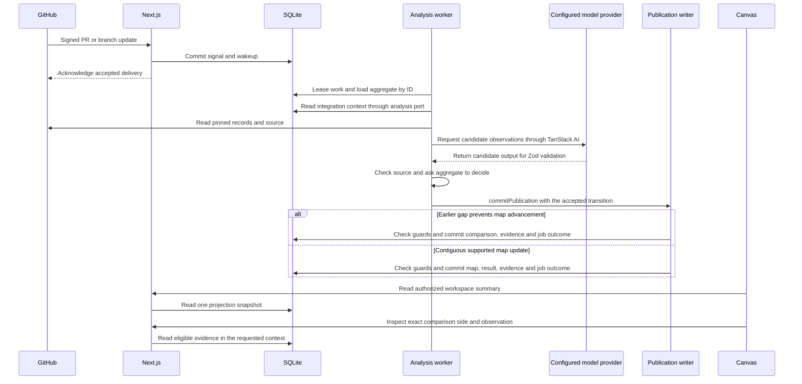

# Program design for the first operational slice

Revised program design for product-owner review. The approved epic scope covers one private workspace, one repository, and one area configured by path. Flask #4692 is the controlled source correspondence case. Narys is the live GitHub App case. [Epic scope approval](../approvals/v1-first-slice-epic.md) · [Epic and AC-01 through AC-05](v1-first-operational-slice.md) · [Engineering baseline](../approvals/v1-first-slice-baseline.md) · [Design baseline](../approvals/v1-design-baseline.md) · [Glossary](../../GLOSSARY.md)

Apply the adopted general and TypeScript profiles to the new web and worker code. The adopted manifest digest is `2e02e07dae2a17600eb8fa6c934b905d23a16e95429a6ae876b09f2a0e6f0e29`. It covers the two local skill directories, including their reference files. The applicable shared standards and setup references match `585021a08441aa095cfb8352e48557591b516303`. [Standards approval](../approvals/v1-first-slice-baseline.md#scoped-standards-adoption-update)

Use Next.js and Better Auth, TanStack Query, nuqs, Drizzle ORM with `better-sqlite3` and Drizzle Kit, Zod, and TanStack AI with direct provider adapters. Use Vitest for unit and integration coverage and Playwright Test for the browser journey. Exact versions and commands belong to operator-led repository setup. [Scoped stack update](../approvals/v1-first-slice-baseline.md#scoped-stack-update) · [Direct inference](../adr/adr-0021-direct-model-inference.md)

To reproduce the adopted digest, run this command from the repository root.

```sh
git ls-files --cached --others --exclude-standard -- \
  .agents/skills/engineering-standards .agents/skills/typescript-standards \
  | LC_ALL=C sort -u | xargs shasum -a 256 | shasum -a 256
```

## Files

Production paths below are proposed. Use the singular feature directory `src/feature/architecture/` for this slice. The architecture feature owns area configuration, map publication, merge review and workspace access. The Architecture Workspace is the overall experience. The Canvas renders the architecture map. Next.js route files delegate to feature API adapters. `src/bootstrap/` wires concrete adapters for the web, worker and operator entry points. Commands and queries have separate contracts over one SQLite database. The web and worker use one release image.

| Path | Action | Responsibility |
|---|---|---|
| `src/feature/architecture/domain/identity.ts` | Create | Semantic IDs, `SourceReferenceDecoder` for commit and path validation, and checked source line ranges. |
| `src/feature/architecture/domain/observations.ts` | Create | Immutable architecture map and integration comparison construction. Validate scope ancestry, relationship endpoints and evidence references. |
| `src/feature/architecture/domain/architecture-workspace.ts` | Create | The ArchitectureWorkspace aggregate owns area configuration and decides when the current map can advance. |
| `src/feature/architecture/application/workspace-commands.ts` | Create | Authorize setup, accept verified delivery signals and use the command-side persistence contracts. |
| `src/feature/architecture/application/analysis-worker.ts` | Create | Coordinate lease processing, reconciliation, bounded code checks, and aggregate publication. Own the analysis and job ports. |
| `src/feature/architecture/application/workspace-access.ts` | Create | Enforce roles and repository access, session expiry, and check freshness. Own the user access port. |
| `src/feature/architecture/application/workspace-queries.ts` | Create | Own the authorized read port and resolve a summary, comparison side, scope, or observation. |
| `src/feature/architecture/view-contract.ts` | Create | Browser-safe view contracts and Zod validation through `WorkspaceViewDecoder`. |
| `src/feature/architecture/api/workspace-http.ts` | Create | Decode workspace requests and browser session context. Map setup and view results onto HTTP. |
| `src/feature/architecture/api/github-webhook.ts` | Create | Enforce bounded intake, verify the delivery signature over raw bytes, decode required fields and invoke the intake command. |
| `src/feature/architecture/infrastructure/access/github-user-access.ts` | Create | Verify repository access with a GitHub App user token. |
| `src/feature/architecture/infrastructure/access/session-better-auth.ts` | Create | Handle GitHub OAuth and sessions through the Better Auth Drizzle adapter. Translate provider identity and expiry at the authentication boundary. |
| `src/feature/architecture/infrastructure/access/schema-auth-sqlite.ts` | Create | Provide the Better Auth SQLite table definitions as an input to Drizzle Kit. Keep identity and session schema ownership with the auth adapter. |
| `src/feature/architecture/infrastructure/adapters/sqlite/analysis-read-adapter-sqlite.ts` | Create | Read intake and publication context for the analysis worker. |
| `src/feature/architecture/infrastructure/adapters/sqlite/database-sqlite.ts` | Create | Own the `better-sqlite3` connection lifecycle and settings. Provide the server-side Drizzle client. |
| `src/feature/architecture/infrastructure/adapters/sqlite/schema-sqlite.ts` | Create | Define Drizzle tables, indexes, and constraints for the Architecture feature. Keep persistence types inside infrastructure. |
| `src/feature/architecture/infrastructure/adapters/sqlite/read-adapter-sqlite.ts` | Create | Project revision and evidence records under a consistent read snapshot. |
| `src/feature/architecture/infrastructure/analysis/ast-checker.ts` | Create | Check declarations, calls and bindings in pinned Python and TypeScript source. |
| `src/feature/architecture/infrastructure/inference/tanstack-ai-adapter.ts` | Create | Implement `CandidateModel` with the operator-configured OpenAI, Anthropic, or Ollama adapter. Pass cancellation through and validate candidates with Zod. |
| `src/feature/architecture/infrastructure/mappers/workspace-persistence-mapper-sqlite.ts` | Create | Reconstitute the workspace aggregate from a validated SQLite record and map its state to writable columns. |
| `src/feature/architecture/infrastructure/mappers/workspace-view-mapper-sqlite.ts` | Create | Assemble browser-safe views from authorized projection rows and preserve source revision bindings. |
| `drizzle.config.ts` and `src/feature/architecture/infrastructure/migrations/sqlite/` | Create | Configure Drizzle Kit to read the Architecture and auth schemas. Check in its initial SQL and migration metadata under the feature. Reuse the schema for both tickets and keep applied migrations immutable. |
| `src/feature/architecture/infrastructure/repositories/github-repository.ts` | Create | Read source, history and PR records using the GitHub App installation identity. |
| `src/feature/architecture/infrastructure/repositories/workspace-repository-sqlite.ts` | Create | Load the Architecture Workspace aggregate and its version by workspace ID. |
| `src/feature/architecture/infrastructure/stores/access-store-sqlite.ts` | Create | Store role grants and repository access checks. |
| `src/feature/architecture/infrastructure/stores/job-store-sqlite.ts` | Create | Record accepted deliveries, claim due work and track recovery. |
| `src/feature/architecture/infrastructure/writers/workspace-publication-writer-sqlite.ts` | Create | Commit setup and its first job or an accepted publication with the applicable transaction guards. |
| `src/bootstrap/config.ts` | Create | Validate process settings with Zod. Resolve the worker's selected provider, model, endpoint where applicable, and required credentials. |
| `src/bootstrap/{web,worker,operator}.ts` | Create | Compose entry points with constructor injection. Drive worker scheduling, coordinate schema migrations and manage local roles. Own diagnostics and shutdown. |
| `src/app/layout.tsx`, `src/app/page.tsx` and `src/app/GitHubSignIn.tsx` | Create | Provide the application shell, nuqs App Router adapter, GitHub sign-in entry, and private workspace URL. |
| `src/app/api/auth/[...all]/route.ts` | Create | Route Better Auth requests. |
| `src/app/api/github/webhook/route.ts` | Create | Accept qualifying signed PR and branch-update deliveries at one endpoint. |
| `src/app/workspace/[workspaceId]/page.tsx` | Create | Authorize and render the private workspace or setup state on the server. |
| `src/app/api/workspaces/[workspaceId]/setup/route.ts` | Create | Authorize maintainer setup and validate the submitted path. |
| `src/app/api/workspaces/[workspaceId]/view/route.ts` | Create | Serve summary, scoped canvas, and observation requests through the protected read boundary. |
| `src/feature/architecture/ui/{workspace.tsx,canvas.tsx,index.ts}` | Create | Compose the workspace with TanStack Query for protected reads and nuqs for restorable scope and comparison state. Keep viewport and focus local. Export the supported component surface to the application and Storybook. |
| `src/feature/architecture/ui/{inspector,revision-switch,architecture-node-face,code-symbol-card}.tsx` | Create | Port the approved evidence, revision, node and code-card components to the production read model. |
| `src/feature/architecture/ui/{architecture-visuals.tsx,workspace.css}` | Create | Reuse in-scope semantic marks, static treatments and Carbon tokens. |
| `src/ui/primitives/{button,badge}.tsx` and `src/ui/primitives/class-names.ts` | Create | Reuse the source-owned shadcn/ui controls and their class name helper. |
| `docs/design/prototypes/canvas-storybook/src/OperationalWorkspace.stories.tsx` | Create | Exercise production component imports with adapters for private setup, pinned comparisons, uncertain attribution, and analysis gaps. |
| `docs/design/prototypes/canvas-storybook/.storybook/main.ts`, `docs/design/prototypes/canvas-storybook/tsconfig.json` and `docs/design/prototypes/canvas-storybook/{package.json,package-lock.json}` | Change as needed | Resolve production imports, tokens, and a single React runtime. Keep approved baseline preview URLs available. |
| `package.json`, `package-lock.json`, `tsconfig.json`, `tsconfig.worker.json`, `next.config.ts`, `postcss.config.mjs` and `.gitignore` | Create | Define the reproducible TypeScript app and worker builds, existing UI foundation's CSS processing, runtime scripts, and local artifact exclusions. |
| `eslint.config.mjs`, `prettier.config.mjs`, `.dependency-cruiser.cjs` and `vitest.config.ts` | Create | Configure the formatter, type-aware lint, resolved dependency checks, and Vitest unit and integration tests through repository setup. |
| `playwright.config.ts` and `.github/workflows/verify.yml` | Create | Run Playwright Test browser acceptance and the approved build and validation commands. CI verification has no release authority. |
| `Dockerfile`, `.dockerignore`, `compose.yaml` and `.env.example` | Create | Package web and worker from one image with distinct services and a local SQLite volume. Document worker-only provider settings with placeholder credentials. |
| `tests/access.test.ts`, `tests/ingestion.test.ts`, `tests/source-checks.test.ts`, `tests/publication.test.ts`, `tests/migrations.test.ts` and `tests/model-route.test.ts` | Create | Exercise public application or adapter boundaries, generated migrations, real SQLite transactions, source gates, and configured destinations. |
| `tests/contracts.types.ts` and `tests/boundaries.test.ts` | Create | Exercise negative type cases, runtime decoders and forbidden dependency edges. |
| `tests/fixtures/{flask-4692,github-events,workspace}.ts` and `tests/workspace.spec.ts` | Create | Define pinned record locators and approved or synthetic test inputs. Run the controlled path through worker, HTTP and browser. |
| `tests/critical-properties.test.ts` | Create | Execute the small state model and replay failing witnesses at the application boundary. |
| `docs/verification/PROP-001-revision-bound-disclosure.{md,yaml}`, `docs/verification/PROP-002-atomic-publication.{md,yaml}` and `docs/verification/PROP-003-contiguous-map-advancement.{md,yaml}` | Create | Record proposed property-to-code mappings through the formal verification workflow. |
| `.agents/skills/verify-workspace-properties/SKILL.md` | Create when verified | Record the actual commands, correspondence checks, and failing witnesses through the separately authorized formal verification workflow. |
| `AGENTS.md`, `REVIEW.md` and `docs/how-to/run-private-pilot.md` | Change or create when verified | Record actual local and CI checks, plus the tested private setup and recovery procedure. Managed branch enforcement and its approval use the repository tooling workflow. |

The visual sources are the pinned [node face](https://github.com/matejpalenik/narys/blob/61111d539ef99a54add32233229e1098528c0600/docs/design/prototypes/canvas-storybook/src/ArchitectureNodeFace.tsx), [code card](https://github.com/matejpalenik/narys/blob/61111d539ef99a54add32233229e1098528c0600/docs/design/prototypes/canvas-storybook/src/CodeSymbolCard.tsx), [inspector](https://github.com/matejpalenik/narys/blob/61111d539ef99a54add32233229e1098528c0600/docs/design/prototypes/canvas-storybook/src/Inspector.tsx), and [approved stories](../approvals/v1-design-baseline.md). Transfer compatible rendering and tokens. Keep fixture behavior and animation in the prototype. Use the same production components for new component evidence and browser checks.

Domain imports remain framework-independent. The application imports domain values and owns external ports. Group infrastructure implementations by role. The SQLite connection and read projection adapter live in `adapters/sqlite/`. The Architecture schema migrations live in `infrastructure/migrations/sqlite/`. API adapters delegate to the application. The client uses the view contract and UI components. Apply these rules to type-only imports and verify the transitive client graph excludes server entry points, secrets and storage. [Role-based grouping](../../.agents/skills/engineering-standards/references/code-organization.md#role-based-grouping-within-a-feature) · [Feature-owned migrations](../../.agents/skills/engineering-standards/references/code-organization.md#feature-owned-migrations) · [Feature layout and dependency rules](../../.agents/skills/typescript-standards/references/architecture.md)

## Types and signatures

These are TypeScript declarations for review. Their TSDoc records the known contracts to carry into source. Construct and match closed choices through named values such as `ElementFactKind.container`. The strings in the value sets are the serialized values. The browser-safe view contract exposes the relevant shared values to UI callers. Domain classes own construction and transitions. Group public decoding methods in static classes named for the values they decode. The application coordinates authorization, leases and external calls. SQLite enforces version, lease and integrity constraints at commit. The browser consumes the explicit view contract. [TypeScript documentation standard](../../.agents/skills/typescript-standards/references/tooling.md#tsdoc)

**Domain** · `domain/identity.ts`, `domain/observations.ts`, and `domain/architecture-workspace.ts`.

```ts
declare const identity: unique symbol;
/** Distinguishes domain values that share the same primitive representation. */
type Brand<T, Name extends string> = T & { readonly [identity]: Name };
/** Identifies the workspace independently of a repository path or selected map revision. */
type WorkspaceId = Brand<string, "WorkspaceId">;
/** Identifies the connected GitHub repository across name changes. */
type RepositoryId = Brand<number, "RepositoryId">;
/** Identifies the GitHub App installation authorized to supply repository evidence. */
type InstallationId = Brand<number, "InstallationId">;
/** Identifies a navigable location in the architecture map's scope hierarchy. */
type ScopeId = Brand<string, "ScopeId">;
/** Identifies the same architectural element across revisions when continuity is established. */
type ElementId = Brand<string, "ElementId">;
/** Identifies a relationship whose meaning can be inspected at a source revision. */
type RelationshipId = Brand<string, "RelationshipId">;
/** Identifies the individual assertion to which source evidence is attached. */
type ClaimId = Brand<string, "ClaimId">;
/** Identifies a saved excerpt within its authorized claim and revision context. */
type EvidenceId = Brand<string, "EvidenceId">;
/** Identifies a comparison for an established before-and-after branch interval. */
type ComparisonId = Brand<string, "ComparisonId">;
/** Carries a validated full commit hash for a pinned source read. */
type CommitSha = Brand<string, "CommitSha">;
/** Carries a validated path relative to the connected repository root. */
type RepositoryPath = Brand<string, "RepositoryPath">;
/** Milliseconds since the Unix epoch for session expiry, leases and retry times. */
type EpochMs = Brand<number, "EpochMs">;
/** Derives the member values of an owned set of named choices. */
type ValueOf<T> = T[keyof T];
/** Requires a first entry for contracts that rely on at least one claim or excerpt. */
type NonEmpty<T> = readonly [T, ...T[]];
/** Identifies validation outcomes. */
const ValidationKind = Object.freeze({ valid: "valid", invalid: "invalid" } as const);

/** Carries a checked value or the reason the input could not be accepted. */
type Validation<T> = { readonly kind: typeof ValidationKind.valid; readonly value: T }
  | { readonly kind: typeof ValidationKind.invalid; readonly reason: string };
/** Validates the repository coordinates used to pin source evidence. */
declare class SourceReferenceDecoder {
  private constructor();

  /**
   * Accepts a full commit hash for revision-pinned source reads.
   *
   * @param raw - Candidate hash from an untrusted input.
   * @returns A branded commit hash or a validation failure.
   */
  static decodeCommitSha(raw: unknown): Validation<CommitSha>;

  /** Validates a normalized path relative to the repository root. Repository reads establish existence. */
  static decodeRepositoryPath(raw: unknown): Validation<RepositoryPath>;
}

/** Pins an integration's earlier and resulting commits in the same repository. */
interface RevisionPair { readonly before: CommitSha; readonly after: CommitSha }
/** Identifies the configured GitHub target, its installation and the branch Narys follows. */
interface Repository {
  readonly id: RepositoryId; readonly installationId: InstallationId;
  readonly owner: string; readonly name: string; readonly branch: string;
}
/** Identifies the workspace and selected path that bound source analysis. */
interface ScopedWorkspace {
  readonly id: WorkspaceId; readonly repository: Repository; readonly selectedPath: RepositoryPath;
}
/** Identifies a commit within the repository that supplies the evidence. */
interface SourceRevision { readonly repositoryId: RepositoryId; readonly commit: CommitSha }

/** Supplies the pinned file identity and line bounds for a checked excerpt. */
interface CheckedSourceLocationInput {
  readonly revision: SourceRevision;
  readonly path: RepositoryPath;
  readonly fileLineCount: number;
  readonly firstLine: number;
  readonly lastLine: number;
}

/** Identifies a checked line range in a file at a pinned source revision. */
declare class SourceLocation {
  private constructor();
  private readonly checkedRange: { readonly firstLine: number; readonly lastLine: number };

  /** Creates an inclusive, one-based line range within the pinned file's line count. */
  static fromChecked(input: CheckedSourceLocationInput): Validation<SourceLocation>;
  readonly revision: SourceRevision;
  readonly path: RepositoryPath;
  get firstLine(): number;
  get lastLine(): number;
}
/** Preserves the text used for a source check and its revision-pinned GitHub link. */
interface SourceExcerpt {
  readonly id: EvidenceId; readonly location: SourceLocation;
  readonly excerpt: string; readonly githubUrl: string;
}
/** Identifies the revision scope of source evidence. */
const ClaimEvidenceKind = Object.freeze({
  atRevision: "at-revision",
  beforeAfter: "before-after",
} as const);

/** Carries decisive excerpts at one revision or separately for both sides of a change. */
type ClaimEvidence<Excerpt = SourceExcerpt> =
  | { readonly kind: typeof ClaimEvidenceKind.atRevision; readonly excerpts: NonEmpty<Excerpt> }
  | { readonly kind: typeof ClaimEvidenceKind.beforeAfter; readonly before: NonEmpty<Excerpt>; readonly after: NonEmpty<Excerpt> };
/** Identifies what an architecture claim concerns. */
const ClaimSubjectKind = Object.freeze({
  element: "element",
  relationship: "relationship",
  change: "change",
} as const);

/** Identifies the element, relationship or integration comparison the claim describes. */
type ClaimSubject =
  | { readonly kind: typeof ClaimSubjectKind.element; readonly id: ElementId }
  | { readonly kind: typeof ClaimSubjectKind.relationship; readonly id: RelationshipId }
  | { readonly kind: typeof ClaimSubjectKind.change; readonly comparisonId: ComparisonId };
/** Keeps an assertion and its subject identifiable across its evidence and display records. */
interface ClaimIdentity {
  readonly id: ClaimId; readonly subject: ClaimSubject; readonly statement: string;
}
/** Names the source correspondence results used by the map and inspector. */
const ClaimStatus = Object.freeze({
  supported: "supported",
  possibleDivergence: "possible-divergence",
  unconfirmed: "unconfirmed",
} as const);

/** Records source support, a contradiction or unresolved evidence for an architectural assertion. */
type CheckedClaim = ClaimIdentity & (
  | { readonly kind: typeof ClaimStatus.supported; readonly evidence: ClaimEvidence }
  | { readonly kind: typeof ClaimStatus.possibleDivergence; readonly evidence: ClaimEvidence; readonly recordedClaim: string; readonly recordUrl: string }
  | { readonly kind: typeof ClaimStatus.unconfirmed; readonly reason: string; readonly availableExcerpts: readonly SourceExcerpt[] }
);
/** Defines a navigable part of the architecture map and its parent scope. */
interface Scope {
  readonly id: ScopeId; readonly parentId: ScopeId | null;
  readonly ownerElementId?: ElementId; readonly label: string;
}
/** Names the element kinds and their serialized values. */
const ElementFactKind = Object.freeze({
  system: "system",
  container: "container",
  component: "component",
  module: "module",
  class: "class",
  function: "function",
  interface: "interface",
  type: "type",
} as const);
/** The classification of an element at a source revision. */
type ElementFactKind = ValueOf<typeof ElementFactKind>;

/** Describes an architectural element within one map and identifies the claims that support it. */
interface ElementFact {
  readonly id: ElementId; readonly scopeId: ScopeId; readonly name: string;
  readonly kind: ElementFactKind;
  readonly role?: string; readonly responsibility?: string; readonly signature?: string;
  readonly technology?: string; readonly claimIds: NonEmpty<ClaimId>;
}
/** Names the architectural relationships established through source checks. */
const RelationshipKind = Object.freeze({
  call: "call",
  registration: "registration",
  configuration: "configuration",
  dependency: "dependency",
  inheritance: "inheritance",
} as const);
/** The architectural meaning of a link between elements. */
type RelationshipKind = ValueOf<typeof RelationshipKind>;

/** Links the endpoints of a relationship within a map and identifies its supporting claims. */
interface RelationshipFact {
  readonly id: RelationshipId; readonly scopeId: ScopeId; readonly from: ElementId; readonly to: ElementId;
  readonly kind: RelationshipKind;
  readonly label: string; readonly claimIds: NonEmpty<ClaimId>;
}
/** Holds the scope hierarchy, elements, relationships and claims at one source revision. */
interface ArchitectureMapSnapshot {
  readonly revision: SourceRevision; readonly root: ScopeId; readonly scopes: readonly Scope[];
  readonly elements: readonly ElementFact[]; readonly relationships: readonly RelationshipFact[];
  readonly claims: readonly CheckedClaim[];
}
/** Represents the checked architecture of an area at one source revision. */
declare class ArchitectureMap {
  private constructor();
  private readonly checkedSnapshot: ArchitectureMapSnapshot;

  /** Checks scope ancestry, relationship endpoints and claim references in one source revision. */
  static fromChecked(snapshot: ArchitectureMapSnapshot): Validation<ArchitectureMap>;
  snapshot(): ArchitectureMapSnapshot;
}

/** Identifies how repository evidence attributes an integration. */
const AttributionKind = Object.freeze({ pullRequest: "pull-request", branch: "branch" } as const);

/** Records a supported PR association or the reason the comparison remains at branch level. */
type Attribution =
  | { readonly kind: typeof AttributionKind.pullRequest; readonly number: number; readonly title: string; readonly url: string }
  | { readonly kind: typeof AttributionKind.branch; readonly reason: string };
/** Identifies whether an existing record supplies the reason for a change. */
const RationaleKind = Object.freeze({ recorded: "recorded", missing: "missing" } as const);

/** Names the records that can supply rationale. */
const RationaleSource = Object.freeze({
  pullRequest: "pull-request",
  commit: "commit",
  linkedRecord: "linked-record",
} as const);
/** The kind of record that supplied the rationale for a change. */
type RationaleSource = ValueOf<typeof RationaleSource>;

/** Carries the reason found in an existing record or the explicit missing-rationale state. */
type RecordedRationale =
  | { readonly kind: typeof RationaleKind.recorded; readonly summary: string; readonly source: RationaleSource; readonly url: string }
  | { readonly kind: typeof RationaleKind.missing };
/** Names the deployment state available in the first operational slice. */
const DeploymentStatus = Object.freeze({ unconfirmed: "unconfirmed" } as const);

/** Carries deployment status separately from the evidence that an integration reached the branch. */
interface Deployment { readonly kind: typeof DeploymentStatus.unconfirmed }
/** Describes an established branch interval. GitHub evidence determines its PR attribution. */
interface Integration {
  readonly workspaceId: WorkspaceId; readonly revisions: RevisionPair; readonly attribution: Attribution;
}
/** Connects the prior and new owners of a responsibility to their respective claims. */
interface ResponsibilityChange {
  readonly before: { readonly owner: ElementId; readonly claimId: ClaimId };
  readonly after: { readonly owner: ElementId; readonly claimId: ClaimId };
}
/** Names how an architecture observation changes across a comparison. */
const ArchitectureChangeKind = Object.freeze({
  added: "added",
  modified: "modified",
  removed: "removed",
} as const);
/** A change marker for a selected before-and-after comparison. */
type ArchitectureChangeKind = ValueOf<typeof ArchitectureChangeKind>;

/**
 * Holds the checked architecture changes between two commits on the tracked branch.
 *
 * @remarks
 * The before and after snapshots describe the selected area at the commits in
 * `integration.revisions`. GitHub evidence can attribute the interval to one PR.
 * When PR attribution is unconfirmed, the snapshot still describes the supported
 * branch comparison. It can be inspected while the current map stays at an earlier revision.
 */
interface IntegrationComparisonSnapshot {
  readonly id: ComparisonId;
  readonly integration: Integration;
  readonly before: ArchitectureMapSnapshot;
  readonly after: ArchitectureMapSnapshot;
  readonly changes: readonly {
    readonly kind: ArchitectureChangeKind;
    readonly subject: ClaimSubject;
    readonly claimIds: NonEmpty<ClaimId>;
  }[];
  readonly responsibilityChanges: readonly ResponsibilityChange[];
  readonly affectedBehavior: readonly ClaimId[];
  readonly rationale: RecordedRationale;
  readonly deployment: Deployment;
}
/** Connects a tracked branch interval to its architectural changes and decisive evidence. */
declare class IntegrationComparison {
  private constructor();
  private readonly checkedSnapshot: IntegrationComparisonSnapshot;

  /** Checks that the snapshots and decisive excerpts match their labeled comparison sides. */
  static fromChecked(input: IntegrationComparisonSnapshot): Validation<IntegrationComparison>;
  snapshot(): IntegrationComparisonSnapshot;
}

/** Names the map lifecycle states owned by the workspace. */
const WorkspaceStateKind = Object.freeze({
  unconfigured: "unconfigured",
  building: "building",
  published: "published",
} as const);

/** Tracks whether an area is configured and which source revision its current map describes. */
type ArchitectureWorkspaceState =
  | { readonly kind: typeof WorkspaceStateKind.unconfigured; readonly id: WorkspaceId; readonly repository: Repository }
  | { readonly kind: typeof WorkspaceStateKind.building; readonly workspace: ScopedWorkspace; readonly start: CommitSha }
  | { readonly kind: typeof WorkspaceStateKind.published; readonly workspace: ScopedWorkspace; readonly currentMapCommit: CommitSha };
/** Distinguishes area continuity from evidence for a comparison. */
const AreaCoverageKind = Object.freeze({
  continuous: "continuous",
  comparisonOnly: "comparison-only",
} as const);

/** Distinguishes coverage that can advance the current map from evidence scoped to one integration. */
type AreaCoverage =
  | { readonly kind: typeof AreaCoverageKind.continuous; readonly from: CommitSha; readonly resultingMap: ArchitectureMap }
  | { readonly kind: typeof AreaCoverageKind.comparisonOnly };
/** Indicates whether a checked integration includes an architecture change. */
const CheckedIntegrationKind = Object.freeze({
  architectureChange: "architecture-change",
  noArchitectureChange: "no-architecture-change",
} as const);

/** Records the architectural effect established for a branch interval and its area coverage. */
type CheckedIntegration =
  | { readonly kind: typeof CheckedIntegrationKind.architectureChange; readonly comparison: IntegrationComparison; readonly coverage: AreaCoverage }
  | { readonly kind: typeof CheckedIntegrationKind.noArchitectureChange; readonly coverage: AreaCoverage };
/** Identifies the integration and any unresolved predecessor that affects map advancement. */
interface PublicationContext {
  readonly integration: Integration;
  readonly hasUnresolvedPredecessor: boolean;
}
/** Names the effects the aggregate can authorize for publication. */
const PublicationEffectKind = Object.freeze({
  startingMap: "starting-map",
  comparisonOnly: "comparison-only",
  mapUpdate: "map-update",
  resolvedWithoutUpdate: "resolved-without-update",
} as const);

/** Describes the records an accepted workspace decision makes eligible for publication. */
type PublicationEffect =
  | { readonly kind: typeof PublicationEffectKind.startingMap; readonly map: ArchitectureMapSnapshot }
  | { readonly kind: typeof PublicationEffectKind.comparisonOnly; readonly comparison: IntegrationComparisonSnapshot }
  | { readonly kind: typeof PublicationEffectKind.mapUpdate; readonly map: ArchitectureMapSnapshot; readonly comparison?: IntegrationComparisonSnapshot }
  | { readonly kind: typeof PublicationEffectKind.resolvedWithoutUpdate };
declare const acceptedPublication: unique symbol;
/** Carries the next workspace state and the effect the aggregate authorizes for persistence. */
interface PublicationTransition {
  readonly [acceptedPublication]: true;
  readonly state: ArchitectureWorkspaceState;
  readonly effect: PublicationEffect;
}
/** Names the aggregate's decision on a proposed publication. */
const PublishDecisionKind = Object.freeze({
  accepted: "accepted",
  recheck: "recheck",
  rejected: "rejected",
} as const);

/** Reports whether publication can proceed, needs fresh coverage, or must be rejected. */
type PublishDecision =
  | { readonly kind: typeof PublishDecisionKind.accepted; readonly transition: PublicationTransition }
  | { readonly kind: typeof PublishDecisionKind.recheck }
  | { readonly kind: typeof PublishDecisionKind.rejected; readonly reason: string };
/** Names the outcomes of selecting the workspace's initial area. */
const WorkspaceSetupResult = Object.freeze({
  configured: "configured",
  alreadyConfigured: "already-configured",
} as const);
/** The outcome of configuring the aggregate's initial area. */
type WorkspaceSetupResult = ValueOf<typeof WorkspaceSetupResult>;

/** Pins the selected area to its starting source revision. */
interface ConfigureArchitectureArea {
  readonly path: RepositoryPath;
  readonly start: CommitSha;
}

/** Pairs a checked result with the branch context that governs map advancement. */
interface PublishIntegrationInput {
  readonly context: PublicationContext;
  readonly change: CheckedIntegration;
}

/** Owns area configuration and decides which results can advance the current map. */
declare class ArchitectureWorkspace {
  private constructor();
  private state: ArchitectureWorkspaceState;

  /** Validates persisted state before the aggregate can make publication decisions. */
  static restore(state: ArchitectureWorkspaceState): Validation<ArchitectureWorkspace>;
  snapshot(): ArchitectureWorkspaceState;

  /** Pins the selected path and starting commit once. Repeated calls keep the original selection. */
  configure(input: ConfigureArchitectureArea): WorkspaceSetupResult;

  /** Accepts a checked starting map at the commit pinned during configuration. */
  publishStartingMap(map: ArchitectureMap): PublishDecision;

  /**
   * Accepts independently supported comparisons while preserving the current map during an earlier gap.
   * Returns `recheck` when area coverage starts at an older current map revision.
   */
  publishIntegrationResult(input: PublishIntegrationInput): PublishDecision;
}
```

Persist stable IDs separately from revision facts. Reuse an ID when a resolved declaration or an unambiguous source-backed rename establishes continuity. An architecture map checks ancestry, endpoints and references at construction. An integration comparison checks its revision pair, the labeled before and after source excerpts, and the evidence for each changed responsibility. A removed observation uses the prior fact and its evidence. Store the checked excerpt with the pinned link derived from the validated repository, full commit, path and line range.

The aggregate makes publication decisions in memory. It holds private state and copies or freezes nested snapshots where necessary. Advancing the current map requires area coverage from its source revision and resolution of the applicable earlier analysis gap. The publication writer persists accepted transitions after checking concurrent state changes.

**Commands and worker** · `application/workspace-commands.ts` and `application/analysis-worker.ts`.

```ts
/** Binds an incoming delivery to the configured installation, repository and branch. */
interface SignalTarget {
  readonly deliveryId: string; readonly installationId: InstallationId;
  readonly repositoryId: RepositoryId; readonly branch: string;
}
/** Identifies the normalized GitHub deliveries accepted for analysis. */
const GitHubSignalKind = Object.freeze({ mergedPr: "merged-pr", branchPush: "branch-push" } as const);

/** Carries a verified target-branch push or merged PR notification for durable intake. */
type GitHubSignal = SignalTarget & (
  | { readonly kind: typeof GitHubSignalKind.mergedPr; readonly number: number; readonly reportedMergeCommit?: CommitSha }
  | { readonly kind: typeof GitHubSignalKind.branchPush; readonly revisions: RevisionPair; readonly forced: boolean }
);
/** Names the analysis jobs the worker can lease. */
const WorkKind = Object.freeze({
  startingMap: "starting-map",
  resolveIntegration: "resolve-integration",
  analyzeIntegration: "analyze-integration",
} as const);

/** Describes which starting map, reconciliation or integration analysis a job will perform. */
type Work =
  | { readonly kind: typeof WorkKind.startingMap; readonly workspaceId: WorkspaceId; readonly commit: CommitSha }
  | { readonly kind: typeof WorkKind.resolveIntegration; readonly workspaceId: WorkspaceId }
  | { readonly kind: typeof WorkKind.analyzeIntegration; readonly integration: Integration };
/** Identifies the current claim on a job for guarded persistence writes. */
type LeaseToken = Brand<string, "LeaseToken">;
/** Binds a job claim to the token and expiry used to protect its completion. */
interface LeaseDetails {
  readonly jobId: string; readonly token: LeaseToken; readonly expiresAt: EpochMs;
}
/** Pairs a unit of work with the claim needed to persist its outcome. */
type Lease<W extends Work = Work> = W & LeaseDetails;
/** Identifies analysis jobs that can produce workspace publication transitions. */
type PublicationWork = Exclude<Work, { kind: typeof WorkKind.resolveIntegration }>;
/** Holds the job lease used to resolve context for one integration. */
type IntegrationAnalysisLease = Lease<Extract<Work, { kind: typeof WorkKind.analyzeIntegration }>>;
/** Distinguishes retryable failures from unresolved results. */
const AnalysisFailureKind = Object.freeze({ retryable: "retryable", unresolved: "unresolved" } as const);

/** Names the dependency and analysis failures that can be retried. */
const RetryableAnalysisReason = Object.freeze({
  sourceUnavailable: "source-unavailable",
  historyUnresolved: "history-unresolved",
  modelUnavailable: "model-unavailable",
  invalidAnalysis: "invalid-analysis",
} as const);
/** The reason work could not complete and may be retried. */
type RetryableAnalysisReason = ValueOf<typeof RetryableAnalysisReason>;

/** Names the source or evidence gaps that leave work unresolved. */
const UnresolvedAnalysisReason = Object.freeze({
  unsupportedSource: "unsupported-source",
  inconsistentEvidence: "inconsistent-evidence",
} as const);
/** The evidence gap that prevents completion. */
type UnresolvedAnalysisReason = ValueOf<typeof UnresolvedAnalysisReason>;

/** Classifies analysis failures by whether the worker can retry them. */
type AnalysisFailure =
  | { readonly kind: typeof AnalysisFailureKind.retryable; readonly reason: RetryableAnalysisReason }
  | { readonly kind: typeof AnalysisFailureKind.unresolved; readonly reason: UnresolvedAnalysisReason };
/** Names the durable outcomes of unsuccessful analysis. */
const JobFailureKind = Object.freeze({ retry: "retry", gap: "gap" } as const);

/** Carries a scheduled retry or an unresolved gap to record against the leased job. */
type JobFailure =
  | { readonly kind: typeof JobFailureKind.retry; readonly failure: Extract<AnalysisFailure, { kind: typeof AnalysisFailureKind.retryable }>; readonly runAt: EpochMs }
  | { readonly kind: typeof JobFailureKind.gap; readonly failure: AnalysisFailure };

/** Carries file text from a pinned repository revision for evidence checks. */
interface SourceFile extends SourceRevision { readonly path: RepositoryPath; readonly text: string }
/** Identifies a source declaration by file path and qualified name. */
interface ResolvedSymbol { readonly path: RepositoryPath; readonly qualifiedName: string }
/** Names the source conditions a candidate asks the worker to check. */
const SourceExpectation = Object.freeze({ present: "present", absent: "absent" } as const);
/** The source condition the checker must establish. */
type SourceExpectation = ValueOf<typeof SourceExpectation>;

/** Pins a proposed source assertion to a revision and names the declaration it concerns. */
interface CandidateSubject {
  readonly revision: CommitSha; readonly owner: ResolvedSymbol; readonly expected: SourceExpectation;
}
/** Selects the fixed source check a candidate requests. */
const CandidateFactKind = Object.freeze({
  declaration: "declaration",
  call: "call",
  binding: "binding",
} as const);

/** Selects the fixed source check for a proposed declaration, call or binding. */
type CandidateFact = CandidateSubject & (
  | { readonly kind: typeof CandidateFactKind.declaration; readonly expectedKind: ElementFact["kind"] }
  | { readonly kind: typeof CandidateFactKind.call; readonly callee: ResolvedSymbol }
  | { readonly kind: typeof CandidateFactKind.binding; readonly member: string; readonly target: ResolvedSymbol }
);
/** Distinguishes a single source fact from a before-and-after claim. */
const CandidateKind = Object.freeze({ fact: "fact", change: "change" } as const);

/** Carries one proposed fact or a before-and-after claim for independent checking. */
type Candidate =
  | { readonly kind: typeof CandidateKind.fact; readonly fact: CandidateFact }
  | { readonly kind: typeof CandidateKind.change; readonly before: CandidateFact; readonly after: CandidateFact;
      readonly record?: { readonly statement: string; readonly url: string } };
/** Bounds the source and existing records a model can use to propose observations. */
interface AnalysisInput {
  readonly workspace: ScopedWorkspace; readonly revision: CommitSha; readonly baseline?: CommitSha;
  readonly source: readonly SourceFile[]; readonly records: readonly { readonly url: string; readonly text: string }[];
}
/** Names the results of checking an assertion against pinned source. */
const SourceCheckKind = Object.freeze({
  match: "match",
  conflict: "conflict",
  undetermined: "undetermined",
} as const);

/** Reports whether pinned source establishes, contradicts or leaves a candidate unresolved. */
type SourceCheckResult =
  | { readonly kind: typeof SourceCheckKind.match; readonly locations: NonEmpty<SourceLocation> }
  | { readonly kind: typeof SourceCheckKind.conflict; readonly locations: NonEmpty<SourceLocation> }
  | { readonly kind: typeof SourceCheckKind.undetermined; readonly reason: string; readonly locations: readonly SourceLocation[] };
/** Captures the repository cursor, accepted signals and open intervals available to a scan. */
interface IntegrationIntake {
  readonly workspace: ScopedWorkspace; readonly cursor: CommitSha; readonly signals: readonly GitHubSignal[];
  readonly unresolved: readonly RevisionPair[]; readonly signalWatermark: number;
}
/** Records the branch scan frontier, integrations ready for analysis and intervals that need more evidence. */
interface BranchScan {
  readonly integrations: readonly Integration[]; readonly scannedThrough: CommitSha;
  readonly openIntervals: readonly { readonly revisions: RevisionPair; readonly reason: string }[];
}
/** Identifies the tracked repository and path to resolve at its current tip. */
interface ResolveRepositoryArea {
  readonly repository: Repository;
  readonly path: RepositoryPath;
  readonly signal: AbortSignal;
}

/** Identifies the exact repository, commit and path for a source read. */
interface ReadPinnedSourceFile {
  readonly repository: Repository;
  readonly commit: CommitSha;
  readonly path: RepositoryPath;
  readonly signal: AbortSignal;
}

/** Identifies the scope and revisions for a bounded evidence lookup. */
interface GatherAnalysisInput {
  readonly workspace: ScopedWorkspace;
  readonly commit: CommitSha;
  readonly baseline?: CommitSha;
  readonly signal: AbortSignal;
}

/** Supplies the intake records and cancellation signal for a branch scan. */
interface FindRepositoryIntegrations {
  readonly intake: IntegrationIntake;
  readonly signal: AbortSignal;
}

/** Finds source and integration evidence in the configured repository. */
interface RepositoryReader {
  /** Resolves a valid file or folder at the current tip of the tracked branch. */
  resolveArea(input: ResolveRepositoryArea):
    Promise<{ readonly commit: CommitSha; readonly path: RepositoryPath }>;

  /** Reads the file at the requested commit even after the branch moves. */
  readFile(input: ReadPinnedSourceFile): Promise<SourceFile>;

  /** Gathers bounded source and records, including relevant dependencies outside the starting path. */
  readInputs(input: GatherAnalysisInput): Promise<AnalysisInput>;

  /** Establishes revision pairs from branch evidence and reports uncertain attribution or unresolved intervals. */
  findIntegrations(input: FindRepositoryIntegrations): Promise<BranchScan>;
}
/** Supplies the bounded evidence and cancellation signal for an inference request. */
interface ProposeCandidates {
  readonly analysis: AnalysisInput;
  readonly signal: AbortSignal;
}

/** Supplies candidate observations for source correspondence checks. */
interface CandidateModel {
  /** Uses the configured route, honors cancellation, and returns shape-validated candidates for independent source checks. */
  propose(input: ProposeCandidates): Promise<readonly Candidate[]>;
}
/** Supplies a candidate and the pinned files available to establish source support. */
interface CheckSourceCandidate {
  readonly repository: Repository;
  readonly fact: CandidateFact;
  readonly files: readonly SourceFile[];
}

/** Evaluates observable source facts with the bounded set of prewritten checks. */
interface SourceChecks {
  /** Returns `undetermined` when the fixed checks or pinned files cannot resolve the candidate. */
  check(input: CheckSourceCandidate): SourceCheckResult;
}
/** Pairs the workspace aggregate with the version expected by its next write. */
interface LoadedArchitecture {
  readonly aggregate: ArchitectureWorkspace;
  readonly version: number;
}
/** Loads the workspace aggregate and its persistence version by identity. */
interface WorkspaceRepository {
  load(workspaceId: WorkspaceId): LoadedArchitecture | undefined;
}

/** Reads the repository intervals and gaps needed for analysis decisions. */
interface AnalysisReadPort {
  /** Loads the branch cursor, accepted deliveries and unresolved intervals for reconciliation. */
  loadIntake(workspaceId: WorkspaceId): IntegrationIntake | undefined;

  /** Resolves the integration and any earlier gap that can affect map advancement. */
  loadPublicationContext(lease: IntegrationAnalysisLease): PublicationContext | undefined;
}

/** Carries the configured aggregate and the guards for saving setup and queuing its first job. */
interface SaveWorkspaceConfiguration {
  readonly aggregate: ArchitectureWorkspace;
  readonly expectedVersion: number;
  readonly actor: AccessGrant;
}

/** Carries the accepted change and the version and job lease used to guard its commit. */
interface CommitWorkspacePublication {
  readonly transition: PublicationTransition;
  readonly expectedVersion: number;
  readonly lease: Lease<PublicationWork>;
}

/** Names outcomes of saving workspace setup or committing an accepted publication. */
const PublicationWriteResult = Object.freeze({
  saved: "saved",
  conflict: "conflict",
  denied: "denied",
  leaseLost: "lease-lost",
} as const);

/** Reports whether setup committed, encountered a version conflict, or was denied. */
type SaveWorkspaceConfigurationResult =
  | typeof PublicationWriteResult.saved
  | typeof PublicationWriteResult.conflict
  | typeof PublicationWriteResult.denied;

/** Reports whether publication committed, needs a fresh decision, or lost its job lease. */
type CommitWorkspacePublicationResult =
  | typeof PublicationWriteResult.saved
  | typeof PublicationWriteResult.conflict
  | typeof PublicationWriteResult.leaseLost;

/** Commits workspace use-case effects and their related records in local transactions. */
interface WorkspacePublicationWriter {
  /** Rechecks maintainer access and the expected version before atomically saving setup and its first job. */
  saveConfiguration(input: SaveWorkspaceConfiguration): SaveWorkspaceConfigurationResult;

  /**
   * Saves the publication, its evidence, and the job outcome atomically.
   *
   * @returns `saved` after commit, `conflict` if the workspace version or applicable coverage changed,
   * or `lease-lost` if the worker's lease is no longer active.
   */
  commitPublication(input: CommitWorkspacePublication): CommitWorkspacePublicationResult;
}
/** Names the outcomes of accepting a verified delivery. */
const DeliveryIntakeResult = Object.freeze({
  recorded: "recorded",
  duplicate: "duplicate",
  ignored: "ignored",
} as const);
/** The durable intake result used to acknowledge a delivery. */
type DeliveryIntakeResult = ValueOf<typeof DeliveryIntakeResult>;

/** Names outcomes of persisting scan progress or a job failure. */
const JobWriteResult = Object.freeze({
  committed: "committed",
  recorded: "recorded",
  leaseLost: "lease-lost",
} as const);

/** Binds a branch scan to the lease and delivery watermark used to commit its progress. */
interface CommitBranchScan {
  readonly lease: Lease<Extract<Work, { kind: typeof WorkKind.resolveIntegration }>>;
  readonly signalWatermark: number;
  readonly scan: BranchScan;
}

/** Binds a gap or scheduled retry to the lease that can record it. */
interface RecordAnalysisFailure {
  readonly lease: Lease;
  readonly outcome: JobFailure;
}

/** Persists delivery intake, leases, reconciliation progress and outstanding analysis gaps. */
interface AnalysisJobs {
  /** Records an in-scope signal and its wakeup in the same commit. Duplicate deliveries add no work. */
  acceptSignal(signal: GitHubSignal): DeliveryIntakeResult;

  /** Claims one due job with a lease token that guards later writes. */
  leaseDue(now: EpochMs): Lease | undefined;

  /** Saves discovered work and the scan cursor. Signals after the captured watermark remain due. */
  resolve(input: CommitBranchScan): typeof JobWriteResult.committed | typeof JobWriteResult.leaseLost;

  /** Records a gap and any scheduled retry while the lease is active. */
  recordFailure(input: RecordAnalysisFailure): typeof JobWriteResult.recorded | typeof JobWriteResult.leaseLost;
}
/** Carries the requested starting path and the active session context for area setup. */
interface ConfigureWorkspace {
  readonly sessionId: SessionId | null; readonly workspaceId: WorkspaceId;
  readonly path: RepositoryPath; readonly signal: AbortSignal;
}
/** Names the outcomes of an authorized workspace setup request. */
const ConfigureResult = Object.freeze({
  queued: "queued",
  alreadyConfigured: "already-configured",
  invalidPath: "invalid-path",
  temporarilyUnavailable: "temporarily-unavailable",
  denied: "denied",
} as const);
/** The result the workspace setup action returns to its caller. */
type ConfigureResult = ValueOf<typeof ConfigureResult>;
/** Coordinates maintainer setup and durable intake for configured workspaces. */
declare class WorkspaceCommands {
  constructor(deps: {
    readonly access: WorkspaceAccess; readonly workspaces: WorkspaceRepository;
    readonly publicationWriter: WorkspacePublicationWriter;
    readonly repository: RepositoryReader; readonly jobs: AnalysisJobs;
  });

  /** Authorizes the maintainer, pins the starting revision and queues analysis for a newly configured workspace. */
  configure(input: ConfigureWorkspace): Promise<ConfigureResult>;

  /** Accepts a verified, decoded webhook signal. A `recorded` result means intake is durable. */
  acceptDelivery(signal: GitHubSignal): DeliveryIntakeResult;
}
/** Reports whether a worker iteration handled a due job. */
const WorkerRunResult = Object.freeze({ idle: "idle", processed: "processed" } as const);
/** Whether the worker handled a due job. */
type WorkerRunResult = ValueOf<typeof WorkerRunResult>;

/** Supplies the clock and cancellation signal for one analysis iteration. */
interface RunDueAnalysis {
  readonly now: EpochMs;
  readonly signal: AbortSignal;
}

/** Coordinates unattended source analysis and publication for leased work. */
declare class AnalysisWorker {
  constructor(deps: {
    readonly workspaces: WorkspaceRepository; readonly analysisReads: AnalysisReadPort;
    readonly publicationWriter: WorkspacePublicationWriter; readonly jobs: AnalysisJobs;
    readonly repository: RepositoryReader; readonly model: CandidateModel; readonly sourceChecks: SourceChecks;
  });

  /** Handles one due job. A `processed` result can include publication, a recorded gap or a scheduled retry. */
  runDueWork(input: RunDueAnalysis): Promise<WorkerRunResult>;
}
```

The API adapter verifies webhook bytes and decodes the signal before it calls `WorkspaceCommands`. Delivery acceptance and its wakeup are one write transaction. Resolve jobs acknowledge only signals up to the captured watermark. A delivery during a scan leaves a wakeup due. Comparison identity uses workspace and full before/after pair. Late PR evidence can enrich the identical interval in place. If an exact and complete partition becomes available, atomically replace the coarse listing and preserve the prior branch comparison for historical inspection. Apply branch deltas once.

The commands and worker load the aggregate and its version through `WorkspaceRepository.load(workspaceId)`, which reads the row and calls `WorkspacePersistenceMapper.toLoadedArchitecture`. The worker reads branch intake and any integration context through `AnalysisReadPort`. It verifies pinned source before asking the aggregate to decide. `WorkspacePublicationWriter.commitPublication` checks the expected version, active lease and applicable coverage inside the write transaction. It commits the result, evidence, map pointer and job outcome together. A changed gap or coverage record that invalidates the decision returns `conflict`. The worker reloads or requeues that decision. Recoverable dependency failures take the typed retry path. Keep the earlier map when coverage stays unresolved.

Decode external JSON as `unknown` in each owning adapter. Reuse one authoritative runtime schema per contract and infer the equivalent wire type from that schema. Map into validated domain types and construct an architecture map or integration comparison at its owner. Schema validity establishes shape only. The worker checks expected revisions, paths and record locators, runs the bounded AST checks, and composes supported descriptions from checked facts. A failed lookup alone cannot prove absence. Unsupported syntax, dynamic dispatch or incomplete evidence produces an unconfirmed result. A successful model response with an empty list cannot resolve a material changed dependency.

**Authorization and workspace reads** · `application/workspace-access.ts`, `application/workspace-queries.ts`, and `view-contract.ts`.

```ts
/** Names the roles that can be granted for a private workspace. */
const WorkspaceRole = Object.freeze({ viewer: "viewer", maintainer: "maintainer" } as const);
/** The user's local role for the current workspace. */
type WorkspaceRole = ValueOf<typeof WorkspaceRole>;
/** Identifies the browser sign-in session used for protected workspace operations. */
type SessionId = Brand<string, "SessionId">;
/** Identifies the signed-in GitHub account independently of its email and display name. */
type GitHubUserId = Brand<number, "GitHubUserId">;
/** Binds a successful authorization decision to a session and repository for a protected operation. */
interface AccessGrant {
  readonly workspaceId: WorkspaceId; readonly repositoryId: RepositoryId; readonly githubUserId: GitHubUserId;
  readonly role: WorkspaceRole; readonly sessionId: SessionId;
  readonly sessionExpiresAt: EpochMs; readonly repositoryVerifiedAt: EpochMs;
}
/** Provides the GitHub identity and expiry used to authorize a workspace request. */
interface ActiveSession {
  readonly id: SessionId; readonly githubUserId: GitHubUserId; readonly expiresAt: EpochMs;
}
/** Identifies the workspace and GitHub account whose local grant is needed. */
interface ReadWorkspaceRole {
  readonly workspaceId: WorkspaceId;
  readonly githubUserId: GitHubUserId;
}

/** Identifies a successful repository verification by session and repository. */
interface RepositoryAccessLookup {
  readonly sessionId: SessionId;
  readonly repositoryId: RepositoryId;
}

/** Records when a session last proved access to a repository. */
interface RememberRepositoryVerification {
  readonly sessionId: SessionId;
  readonly repositoryId: RepositoryId;
  readonly verifiedAt: EpochMs;
}

/** Reads local roles and sessions and records successful repository access verification. */
interface WorkspaceAccessStore {
  activeSession(sessionId: SessionId): ActiveSession | undefined;
  localRole(input: ReadWorkspaceRole): WorkspaceRole | undefined;

  /** Returns the time of the last successful repository check for this session and repository. */
  lastVerifiedAt(input: RepositoryAccessLookup): EpochMs | undefined;
  rememberVerification(input: RememberRepositoryVerification): void;
}
/** Names outcomes of verifying the signed-in user's repository access. */
const RepositoryAccessResult = Object.freeze({
  allowed: "allowed",
  denied: "denied",
  unavailable: "unavailable",
} as const);
/** The upstream repository access check outcome. */
type RepositoryAccessResult = ValueOf<typeof RepositoryAccessResult>;

/** Identifies the signed-in session and repository to verify with GitHub. */
interface VerifyGitHubRepositoryAccess {
  readonly sessionId: SessionId;
  readonly repository: Repository;
  readonly signal: AbortSignal;
}

/** Supplies upstream repository eligibility for workspace authorization. */
interface GitHubUserAccess {
  /** Checks the repository with the signed-in user's GitHub App token. Returns `unavailable` if GitHub cannot complete the check. */
  verify(input: VerifyGitHubRepositoryAccess):
    Promise<RepositoryAccessResult>;
}
/** Identifies whether the protected operation has an access grant. */
const AccessDecisionKind = Object.freeze({ allow: "allow", denied: "denied" } as const);

/** Identifies the failed condition for a protected workspace request. */
const AccessDenialReason = Object.freeze({
  session: "session",
  role: "role",
  repoAccess: "repo-access",
  verificationUnavailable: "verification-unavailable",
} as const);
/** The condition that blocked workspace access. */
type AccessDenialReason = ValueOf<typeof AccessDenialReason>;

/** Carries the workspace grant or the condition that prevents the protected operation. */
type AccessDecision =
  | { readonly kind: typeof AccessDecisionKind.allow; readonly grant: AccessGrant }
  | { readonly kind: typeof AccessDecisionKind.denied; readonly reason: AccessDenialReason };
/** Names the protected operations a workspace caller can request. */
const WorkspacePermission = Object.freeze({ read: "read", configure: "configure" } as const);
/** The operation the caller must be authorized to perform. */
type WorkspacePermission = ValueOf<typeof WorkspacePermission>;

/** Describes the protected operation and the session and repository it applies to. */
interface AuthorizeWorkspaceOperation {
  readonly sessionId: SessionId | null;
  readonly workspaceId: WorkspaceId;
  readonly repository: Repository;
  readonly permission: WorkspacePermission;
  readonly signal: AbortSignal;
}

/** Evaluates workspace permissions using the session, local role and repository verification. */
declare class WorkspaceAccess {
  constructor(deps: {
    readonly store: WorkspaceAccessStore; readonly github: GitHubUserAccess; readonly now: () => EpochMs;
  });

  /**
   * Checks session expiry and the current role on each call. Reuses a successful GitHub check for at most 60 seconds.
   * Denies access when a due recheck fails.
   */
  authorize(input: AuthorizeWorkspaceOperation): Promise<AccessDecision>;
}

/** Names the two sides of a pinned integration comparison. */
const RevisionSide = Object.freeze({ before: "before", after: "after" } as const);
/** Which revision in a pinned comparison to inspect. */
type RevisionSide = ValueOf<typeof RevisionSide>;
/** Chooses a map revision or a pinned comparison side. */
const ReadContextKind = Object.freeze({ map: "map", comparison: "comparison" } as const);

/** Pins a view to a map revision or to one side of a known integration comparison. */
type ReadContext =
  | { readonly kind: typeof ReadContextKind.map; readonly commit: CommitSha }
  | { readonly kind: typeof ReadContextKind.comparison; readonly comparisonId: ComparisonId; readonly side: RevisionSide; readonly commit: CommitSha };
/** Identifies what a user can inspect in a workspace context. */
const ObservationTargetKind = Object.freeze({
  element: "element",
  relationship: "relationship",
  change: "change",
} as const);

/** Identifies the element, relationship or claim to open within a read context. */
type ObservationTarget =
  | { readonly kind: typeof ObservationTargetKind.element; readonly id: ElementId }
  | { readonly kind: typeof ObservationTargetKind.relationship; readonly id: RelationshipId }
  | { readonly kind: typeof ObservationTargetKind.change; readonly id: ClaimId };
/** Names the contextual actions and unavailable state shown by the inspector. */
const RelatedObservationKind = Object.freeze({
  inspect: "inspect",
  explore: "explore",
  unavailable: "unavailable",
} as const);

/** Describes an inspector action or explains why a related target is unavailable. */
type RelatedObservation =
  | { readonly kind: typeof RelatedObservationKind.inspect; readonly label: string; readonly scopeId: ScopeId; readonly target: ObservationTarget }
  | { readonly kind: typeof RelatedObservationKind.explore; readonly label: string; readonly scopeId: ScopeId; readonly target?: ObservationTarget }
  | { readonly kind: typeof RelatedObservationKind.unavailable; readonly label: string; readonly reason: string };
/** Names the request and response variants shared by workspace reads. */
const WorkspaceViewKind = Object.freeze({
  summary: "summary",
  canvas: "canvas",
  observation: "observation",
} as const);

/** Selects the summary or pins a canvas or observation request to its scope and revision. */
type WorkspaceQuery =
  | { readonly kind: typeof WorkspaceViewKind.summary }
  | { readonly kind: typeof WorkspaceViewKind.canvas; readonly context: ReadContext; readonly scopeId: ScopeId }
  | { readonly kind: typeof WorkspaceViewKind.observation; readonly context: ReadContext; readonly scopeId: ScopeId; readonly target: ObservationTarget };
/** Names the map states shown in the workspace. */
const MapStatusKind = Object.freeze({
  setup: "setup",
  building: "building",
  published: "published",
} as const);

/** Tells the browser whether the area needs setup, is being analyzed, or has a current map. */
type MapStatus =
  | { readonly kind: typeof MapStatusKind.setup }
  | { readonly kind: typeof MapStatusKind.building; readonly path: RepositoryPath }
  | { readonly kind: typeof MapStatusKind.published; readonly path: RepositoryPath; readonly commit: CommitSha; readonly root: ScopeId };
/** Identifies a comparison and the revisions and scopes to open from Recent merges. */
interface MergeListEntry {
  readonly id: ComparisonId; readonly revisions: RevisionPair; readonly attribution: Attribution;
  readonly roots: Readonly<Record<RevisionSide, ScopeId>>;
}
/** Reports the current map, analysis progress and available comparisons in one read. */
interface WorkspaceSummary {
  readonly workspaceId: WorkspaceId; readonly repositoryLabel: string; readonly role: WorkspaceRole;
  readonly map: MapStatus;
  readonly progress: { readonly checking: boolean; readonly gaps: readonly { readonly label: string; readonly reason: string }[] };
  readonly recent: readonly MergeListEntry[];
}
/** Provides the map elements, relationships and change marks for a selected scope and revision. */
interface CanvasView {
  readonly context: ReadContext; readonly scope: Scope; readonly ancestors: readonly Scope[];
  readonly elements: readonly ElementFact[]; readonly relationships: readonly RelationshipFact[];
  readonly marks: readonly { readonly subject: ObservationTarget; readonly change?: ArchitectureChangeKind; readonly uncertainty?: string }[];
}
/** Exposes the checked text and pinned location as a serializable inspector record. */
type SourceExcerptView = Omit<SourceExcerpt, "location"> & {
  readonly location: Pick<SourceLocation, "revision" | "path" | "firstLine" | "lastLine">;
};
/** Presents the source correspondence result and eligible excerpts for the selected claim. */
type ClaimView = ClaimIdentity & (
  | { readonly kind: typeof ClaimStatus.supported; readonly evidence: ClaimEvidence<SourceExcerptView> }
  | { readonly kind: typeof ClaimStatus.possibleDivergence; readonly evidence: ClaimEvidence<SourceExcerptView>; readonly recordedClaim: string; readonly recordUrl: string }
  | { readonly kind: typeof ClaimStatus.unconfirmed; readonly reason: string; readonly excerpts: readonly SourceExcerptView[] }
);
/** Provides the selected item's claims, evidence and contextual actions at a pinned revision. */
interface ObservationView {
  readonly context: ReadContext; readonly target: ObservationTarget; readonly title: string; readonly description?: string;
  readonly claims: readonly ClaimView[]; readonly related: readonly RelatedObservation[];
  readonly change?: Pick<IntegrationComparisonSnapshot, "integration" | "responsibilityChanges" | "affectedBehavior" | "rationale" | "deployment">;
}
/** Names the outcomes of a protected view read. */
const ViewResultKind = Object.freeze({
  ready: "ready",
  denied: "denied",
  unavailable: "unavailable",
} as const);

/** Distinguishes a view the caller may read, a denied request and an unavailable target. */
type ViewResult<T> = { readonly kind: typeof ViewResultKind.ready; readonly value: T }
  | { readonly kind: typeof ViewResultKind.denied } | { readonly kind: typeof ViewResultKind.unavailable };
/** Carries the summary, canvas or observation projection returned by a workspace read. */
type WorkspaceView =
  | { readonly kind: typeof WorkspaceViewKind.summary; readonly data: WorkspaceSummary }
  | { readonly kind: typeof WorkspaceViewKind.canvas; readonly data: CanvasView }
  | { readonly kind: typeof WorkspaceViewKind.observation; readonly data: ObservationView };
/** Pairs an untrusted response with the view kind the browser requested. */
interface DecodeWorkspaceViewResponse {
  readonly queryKind: WorkspaceQuery["kind"];
  readonly raw: unknown;
}

/** Validates request and response shapes shared by the workspace API and browser. */
declare class WorkspaceViewDecoder {
  private constructor();

  /** Validates the query shape. The protected read path resolves access and the requested revision. */
  static decodeQuery(raw: unknown): Validation<WorkspaceQuery>;

  /** Checks that a ready response matches the requested query kind and preserves explicit access or availability results. */
  static decodeResponse(input: DecodeWorkspaceViewResponse): Validation<ViewResult<WorkspaceView>>;
}
/** Pairs a workspace grant with the view the storage adapter must resolve. */
interface ReadAuthorizedWorkspaceView {
  readonly access: AccessGrant;
  readonly query: WorkspaceQuery;
}

/** Reads protected projections and evidence without loading the write aggregate. */
interface WorkspaceReadPort {
  repositoryForAccess(workspaceId: WorkspaceId): Repository | undefined;

  /** Rechecks the local grant and resolves the exact requested revision and target in one read snapshot. */
  read(input: ReadAuthorizedWorkspaceView): ViewResult<WorkspaceView>;
}
/** Supplies the session, workspace and view selection for a protected read. */
interface ReadWorkspaceQuery {
  readonly sessionId: SessionId | null;
  readonly workspaceId: WorkspaceId;
  readonly query: WorkspaceQuery;
  readonly signal: AbortSignal;
}

/** Resolves a requested workspace view through server-side authorization. */
declare class WorkspaceQueries {
  constructor(deps: { readonly access: WorkspaceAccess; readonly reader: WorkspaceReadPort });

  /** Authorizes the request before reading. An absent target in a permitted context returns `unavailable`. */
  read(input: ReadWorkspaceQuery): Promise<ViewResult<WorkspaceView>>;
}
```

Better Auth binds the browser session to the stable GitHub account ID. The GitHub App user token verifies that user's repository access. The installation token serves unattended analysis. Expire the browser session by eight hours from sign-in or the provider token's earlier expiry. Check the local role on every protected request and again in the read snapshot or write transaction. Use a successful repository check for at most 60 seconds. Deny when a due check fails. Keep credentials server-side. [ADR-0013](../adr/adr-0013-workspace-access.md)

The HTTP layer uses `WorkspaceViewDecoder.decodeQuery` and returns the corresponding serializable projection. The browser uses `WorkspaceViewDecoder.decodeResponse` before rendering. A comparison query checks its ID and the requested side's commit. A paired change claim may return both excerpts with their explicit revision labels. A contextual action uses the current inspection context. An authorized request whose target is unavailable gets the existing unavailable state. There is no evidence-ID-only route. The browser view uses plain evidence records without domain class instances. Protected responses require application authorization on reuse. [ADR-0019](../adr/adr-0019-revision-bound-evidence.md) · [SPEC-007, SPEC-014/015 and SPEC-024](../../SPEC.md#3-observable-behavior)

**SQLite mapping** · `infrastructure/mappers/`.

```ts
/** Supplies a stored workspace record and the configured repository used to reconstitute it. */
interface RehydrateWorkspaceInput {
  readonly row: unknown;
  readonly repository: Repository;
}

/** Identifies the SQLite columns that represent workspace state. */
interface WorkspaceSqliteColumns {
  readonly workspace_id: string;
  readonly repository_id: number;
  readonly state: ValueOf<typeof WorkspaceStateKind>;
  readonly selected_path: string | null;
  readonly starting_commit: string | null;
  readonly current_map_commit: string | null;
}

/** Translates workspace state at the SQLite boundary for the repository and publication writer. */
declare class WorkspacePersistenceMapper {
  private constructor();

  /** Validates the row and version, matches the configured repository, and restores the domain aggregate. */
  static toLoadedArchitecture(input: RehydrateWorkspaceInput): Validation<LoadedArchitecture>;

  /** Maps workspace state to columns. The writer controls the version and database write. */
  static toColumns(state: ArchitectureWorkspaceState): WorkspaceSqliteColumns;
}

/** Carries selected projection rows and the workspace, repository and view context they must match. */
interface MapWorkspaceViewInput {
  readonly workspaceId: WorkspaceId;
  readonly repositoryId: RepositoryId;
  readonly query: WorkspaceQuery;
  readonly rows: readonly unknown[];
}

/** Assembles transport views from projection rows selected by the protected read adapter. */
declare class WorkspaceViewMapper {
  private constructor();

  /** Maps selected fields and rejects malformed rows or mismatched workspace, revision or claim references. */
  static toView(input: MapWorkspaceViewInput): Validation<WorkspaceView>;
}
```

Keep both mappers pure. The persistence mapper uses `ArchitectureWorkspace.restore` to enforce domain construction rules. The repository distinguishes an absent row from an invalid stored record. The publication writer uses the mapped columns within its guarded transaction. The read adapter checks the grant and selects eligible records in its read snapshot, then uses the view mapper to assemble the result. Treat invalid stored projections as storage errors and keep them out of browser responses. The mapper preserves comparison sides and their evidence. Straightforward field conversions can stay in their owning adapters. [Persistence and consistency](../../.agents/skills/engineering-standards/references/domain-driven-design.md#persistence-and-consistency) · [Data Mapper pattern](https://martinfowler.com/eaaCatalog/dataMapper.html)

**Canvas composition** · `src/feature/architecture/ui/`.

```ts
/** Canvas pan offsets in CSS pixels. A zoom of 1 represents the original scale. */
interface Viewport { readonly x: number; readonly y: number; readonly zoom: number }
/** Captures the source context, viewport and selection restored when exploration closes. */
interface CanvasFrame {
  readonly context: ReadContext; readonly scopeId: ScopeId; readonly selection?: ObservationTarget;
  readonly viewport: Viewport;
}
/** Keeps the open comparison pinned while the current workspace receives updates. */
interface ReviewSelection {
  readonly comparisonId: ComparisonId; readonly revisions: RevisionPair;
  readonly roots: Readonly<Record<RevisionSide, ScopeId>>; readonly side: RevisionSide;
}
/** Indicates that the inspector is waiting for its selected observation. */
const InspectorLoading = "loading";

/** Distinguishes an observation lookup in progress from the access or availability result. */
type InspectorState = { readonly kind: typeof InspectorLoading } | ViewResult<ObservationView>;
/** Defines the controlled view and viewport that the workspace passes to the canvas. */
interface CanvasProps {
  readonly view: CanvasView; readonly viewport: Viewport; readonly selected?: ObservationTarget;

  /** Requests inspection within the canvas's current scope and source revision. */
  onInspect(target: ObservationTarget): void;
  onViewportChange(viewport: Viewport): void;
}
/** Defines what the inspector displays and how it requests actions within the current context. */
interface InspectorProps {
  readonly view: InspectorState;

  /** Follows a contextual action within the currently selected revision or comparison side. */
  onAction(action: RelatedObservation): void;

  /** Requests dismissal so the workspace can restore focus to the opener. */
  onDismiss(): void;
}
/** Provides the pinned revisions and an action to inspect either side of the comparison. */
interface RevisionSwitchProps {
  readonly revisions: RevisionPair; readonly side: RevisionSide;

  /** Requests a side of the same pinned comparison. */
  onSideChange(side: RevisionSide): void;
}
/** Supplies the authorized first read used to mount the Architecture Workspace. */
interface WorkspaceProps {
  readonly initial: WorkspaceSummary;
}

/** Owns the workspace's comparison, scope, viewport and focus across live updates. */
declare function Workspace(props: WorkspaceProps): React.JSX.Element;
/** Renders the selected architecture view and reports inspection requests to the workspace. */
declare function Canvas(props: CanvasProps): React.JSX.Element;
/** Shows observations and evidence for the active selection and its revision. */
declare function Inspector(props: InspectorProps): React.JSX.Element;
/** Lets the engineer switch sides of the open comparison. */
declare function RevisionSwitch(props: RevisionSwitchProps): React.JSX.Element;
```

Represent scope and the selected comparison and side with nuqs where they should be restorable from a URL. Encode identifiers only. Resolve all restored targets through the protected workspace API. Keep selection, viewport, focus, and return frames in React. Fit the opened scope initially and keep stable node slots across the same comparison.

Use one TanStack Query summary poll per mounted workspace. Make protected view keys specific to the workspace and requested scope, revision, or comparison side. Fetch authorization before reusing protected data in a restored context. Clear protected query data on denial or sign-out. Refresh on refocus and cancel obsolete requests on navigation or unmount. A newer summary refreshes the default map and Recent merges while the open comparison retains its selected revision. Keep status announcements in a stable live region.

## Call stack

1. **Sign in and configure.** Better Auth verifies the GitHub user and repository, then creates a bounded session. The workspace page calls `WorkspaceQueries`. The setup API checks the origin and decodes the session and path. `WorkspaceCommands.configure` authorizes the maintainer, loads the aggregate by workspace ID, resolves the path and tracked branch tip, and calls `ArchitectureWorkspace.configure`. `WorkspacePublicationWriter.saveConfiguration` rechecks the grant and expected version and saves configuration and the initial job in one commit. Repeated setup returns the existing state. Worker processing continues with the browser closed.
2. **Accept and correlate.** The webhook reads a bounded raw request, validates the signature, and decodes qualifying events for the configured installation, repository and branch. Commit the delivery and a wakeup before issuing a success acknowledgement. SQLite failure returns a retryable non-success response. The worker combines the applicable PR, branch and commit records. Use observed branch boundaries and PR correspondence to identify the immediate integration pair for merge-commit, squash and rebase histories. A reported PR base alone cannot establish the pair. With a verified interval but ambiguous PR attribution, publish a branch comparison. With an unverifiable interval, retain an unresolved gap. Record discovered integration jobs and the scanned frontier atomically. A scan does not advance the map. Retry unresolved intervals separately from the scan frontier so newer evidence is discoverable.
3. **Check source and publish.** `AnalysisWorker` leases due work. `WorkspaceRepository.load` provides the aggregate and expected version. For a merge, `AnalysisReadPort.loadPublicationContext` supplies the integration and any earlier gap. `CandidateModel.propose` uses TanStack AI to send permitted text directly to the configured provider and validates candidate output with Zod. The worker checks candidates against pinned revisions and relevant dependencies. It calls `ArchitectureWorkspace.publishStartingMap` or `publishIntegrationResult` with the checked result. An accepted transition goes to `WorkspacePublicationWriter.commitPublication`. A standalone behavior change can finish without an architecture entry. A timeout, incomplete inventory, or recoverable model or source failure leaves a visible gap and schedules retry. A failed Ollama call keeps its local destination on retry. The writer rejects a stale version or lost lease. Restart recovers due leases. After a gap resolves, the worker rechecks continuity from the current map revision and converges without another comparison effect. [ADR-0009](../adr/adr-0009-merged-revision-attribution.md) · [ADR-0020](../adr/adr-0020-first-slice-source-checks.md) · [ADR-0021](../adr/adr-0021-direct-model-inference.md)
4. **Inspect and return.** The mounted workspace refreshes its summary through the same protected read boundary. Select a merge to pin its before and after revisions. On each protected read, the read adapter selects the eligible rows and calls `WorkspaceViewMapper.toView` with the requested context. The inspector shows claims, excerpts, rationale and contextual destinations for that workspace, scope and revision. From a merge or selected element, open the eligible implementation view or source directly. The browser restores the prior viewport, revision, selection and focus on return. Denial clears workspace data on the active client and returns to sign-in or the access state as appropriate. A valid source link goes to GitHub at the pinned commit.



Use SQLite write-ahead logging on a local filesystem with foreign keys, short writer transactions and bounded busy retries. The operator entry point applies checked-in Drizzle Kit migrations from `infrastructure/migrations/sqlite/` before the web and worker start. A version mismatch stops startup. Keep Better Auth and Architecture table definitions in their respective owners and apply changes through the same migration history. Use one connection and transaction per atomic write, with model and GitHub calls outside it. Back up from a consistent SQLite snapshot and rehearse restoration followed by reconciliation. The worker selects a single provider and model at startup and keeps that destination on failure. Exclude credentials and raw evidence from operational logs. [SQLite WAL](https://www.sqlite.org/wal.html) · [Drizzle Kit](https://orm.drizzle.team/docs/drizzle-kit-generate) · [ADR-0011](../adr/adr-0011-v1-persistence.md) · [ADR-0021](../adr/adr-0021-direct-model-inference.md)

The process entry points parse configuration once and inject typed settings. The worker owns the timer, the active work promise and its cancellation. On shutdown, stop leasing, cancel supported network calls, await cleanup and close storage. An unfinished job remains recoverable after lease expiry. Use structured diagnostics for operation, job or delivery ID and outcome. Narrow infrastructure errors and preserve their causes for server-side diagnosis while returning the declared failure result at the API boundary. [TypeScript runtime safety and verification](../../.agents/skills/typescript-standards/references/tooling.md#runtime-safety-and-observability)

## Test plan

Use Vitest for unit and integration checks and Playwright Test for production browser journeys. Apply the checked-in migrations to the real SQLite database used in integration runs. Use locked fixtures at trusted adapter boundaries and check real effects through the highest practical boundary. Flask replay seeds normalized integration inputs into SQLite only in the test harness. The application has no replay route. Exercise real signed intake separately, then run the Narys live check through the deployed private stack. [Conformance cases](../../SPEC.md#4-conformance-cases) · [Verification profiles](../../REVIEW.md#1-required-checks)

**Compiler and repository checks.** For the new web and worker code, enable `strict`, `noUncheckedIndexedAccess`, `exactOptionalPropertyTypes`, `noImplicitOverride`, `noImplicitReturns`, and `noFallthroughCasesInSwitch`. Select module settings for the Next.js app and separate worker build during repository setup. Use compiler-checked exhaustive mappings or `never` for variant handling. Propose one npm lockfile for the production app, typed ESLint checks for unsafe types, unhandled promises and exhaustiveness, one formatter, and resolved import checks. Use the same format, lint, type, boundary, build and test command set locally and in CI. Exact versions and command wiring belong to repository setup. Scope the new rules to owned production code and its verification. [TypeScript tooling and checks](../../.agents/skills/typescript-standards/references/tooling.md)

| Proposed test | Boundary and input | Pass assertion | Trace |
|---|---|---|---|
| `rejects_invalid_types_and_imports` | Compile negative type fixtures and run the resolved dependency checks with a deliberately invalid fixture. | Reject an element ID used as a scope ID, a source SHA replaced by a path, an unknown element kind and a fabricated publication transition. Accept correctly typed inputs. Reject forbidden domain-to-infrastructure and client-to-server imports, including type-only and transitive paths, cycles and unresolved aliases. Removing the relevant check lets the corresponding witness through. | V0 · Updated TypeScript profile |
| `decodes_external_inputs_before_domain_use` | Real API, inference, and Drizzle storage adapters, plus public domain constructors. Include malformed inputs, invalid line ranges, incomplete revision pairs, stored workspace rows and valid pinned records. | Zod rejects malformed values before state change. At the persistence boundary, round-trip each workspace state and its version. Reject a record with an invalid version or a mismatched repository. Domain construction rejects mismatched revisions or references even when the input shape is valid. Check rejection of unknown categories and the configured treatment of unknown keys for local and vendor contracts. | SPEC-005/007/008/021 · CONF-003/005/008 · AC-01/03/04 |
| `applies_checked_in_sqlite_migrations_before_startup` | Operator entry point and real `better-sqlite3` database on a temporary volume. | Create both owned schemas and the migration history from checked-in SQL. Restarting with the same migrations preserves data and the schema version. Web and worker startup reject a missing or incompatible version. | V0/V2 · AC-01 prerequisites |
| `enforces_map_transitions_through_the_aggregate` | Public `ArchitectureWorkspace` methods with checked architecture maps and integration comparisons. | Reject a starting map at an unexpected commit, keep the current map revision on comparison-only publication, and force a recheck for stale coverage. Accept a supported contiguous update only after the gap is resolved. Check real SQLite transactions and stale leases at the publication writer boundary. | SPEC-012/020/021/023 · CONF-001/008/014 · AC-01/04 |
| `publishes_selected_area_without_a_browser` | Setup HTTP, worker and real SQLite. Flask path fixture. | Viewer setup is denied. Maintainer setup records one job at the pinned starting revision. After closing the browser, the worker publishes the map with revision-bound facts. A second visit reads the saved map and material uncertainty. | SPEC-001/004/020/021 · CONF-001 path case and CONF-002 · AC-01/05 |
| `protects_all_views_and_setup_even_for_a_public_repository` | Page and direct API requests as maintainer, viewer, ineligible and anonymous users. Run against both a public and a private repo setting. | Allow eligible viewers to read and only maintainers to configure. Reject wrong roles, expiry at the earlier deadline, revocation on the next protected request, and due GitHub verification failure. Within the approved interval, confirm removal of upstream permission invalidates access. Check protected responses and browser data on denial. | SPEC-004/017/024 · CONF-002/012 private default/015 · AC-05 |
| `acknowledges_only_after_durable_signed_intake` | Real route, SQLite, recorded request bodies with test signatures, both arrival orders and a delivery during a scan. | Success for qualifying events follows durable intake. A failed write never returns accepted. Duplicate deliveries add no effect. Invalid signature, unrelated installation or repo, wrong branch and unmerged PR create no qualifying merge work. Reopening storage recovers accepted work. An in-flight scan leaves the later delivery due. | SPEC-005/012 · CONF-003/008 · AC-02/04 |
| `attributes_each_merge_only_to_its_branch_interval` | Merge commit, squash, multi-commit rebase, adjacent integrations, coalesced update, and late evidence. | Compare the actual immediately prior and resulting SHAs. Publish an independently supported coalesced change with unconfirmed attribution when warranted. Delayed evidence and replay leave stable, non-duplicated effects. Include human and agent authors and exclude verified standalone behavior changes. | SPEC-006/007/012 · CONF-004/008 · AC-02/04 |
| `checks_flask_responsibility_transfer_at_pinned_revisions` | Python checker and workspace journey against immutable Flask F01–F05. | Before identifies response construction in `jsonify()`. After identifies delegation and the configurable provider, the default class binding, and `json.dumps`. Every source opens at the expected revision, path and lines. The PR supplies the motivation. Deployment reads unconfirmed. A checked test file alone produces no test result. | SPEC-007/008/010/011/021 · CONF-005 and applicable CONF-006 · AC-01 |
| `separates_conflicting_missing_and_supported_claims` | Flask synthetic `orjson` claim, unresolved Python and TypeScript binding, changed registration or configuration in a file outside the starting path, and missing rationale. | Cite the built-in serializer as contrary source. Keep unresolved bindings unconfirmed even if the cited file exists. Show the supported work with its own evidence. Show missing rationale only when the available records supply none. A performance goal appears as recorded rationale. | SPEC-008/009/010 · CONF-005/006 · AC-03 |
| `cannot_disclose_evidence_from_another_context` | Protected HTTP and SQLite. Adjacent revisions, isolated comparison, invalid scope, and mismatched targets or projection records. | Read the stored excerpt at an eligible context. Requesting the old claim in the later revision, a target outside its scope, or a foreign evidence ID yields no source. Projection records with mismatched workspace, revision or claim references fail mapping. A corroborated rename preserves stable identity and old facts. | SPEC-004/007/021/023/024 · CONF-002/008/014/015 · AC-01/04/05 |
| `recovers_accepted_work_and_an_independent_later_change` | Stop a worker before publication, replay or reconcile a missed merge, fail earlier source and deliver independently supported and dependent variants of the later merge. | No partial publication or stale-lease write. The later independent comparison has its own pinned evidence. The dependent change cannot appear as supported. The map holds its last supported revision until coverage recovers. After retry and replay, each supported change appears once and earlier evidence is intact. | SPEC-012/021/022/023 · CONF-008/014 · AC-04 |
| `keeps_local_model_evidence_on_its_configured_route` | Compose worker with a representative OpenAI model, Anthropic model, and local-only Ollama model. Use the same public or synthetic input and observe direct destinations. | Confirm the permitted payload, Zod-validated structured result, and cancellation on each route. With Ollama offline and hosted credentials present, confirm zero hosted calls for the local job, including retries. | SPEC-016 · CONF-011 route isolation · AC-05 |
| `keeps_comparison_and_focus_while_the_open_workspace_updates` | Production Playwright Test session and real publisher. Exercise active comparison, incoming merge, no-architecture-change result, and a gap with later independent evidence. | TanStack Query refreshes the summary and Recent merges without reload. Comparison, side, scope, viewport and focused control survive. A restored nuqs URL resolves its own authorized revision. An ineligible session sees no cached evidence. Announce status without moving focus. | SPEC-004/013/018/019/022/023/024 · CONF-007/013/014/015 · AC-04/05 |
| `reviews_and_returns_using_only_the_keyboard` | Browser acceptance on the same graph, inspector, and controls tested in Storybook. Use a spoken screen reader as a separate manual check. | Traverse merge list, revision control, relationship, evidence and implementation link. Guided and direct paths retain revision and comparison. Return restores scope, viewport, selection and focus. Verify names, announcements and readable uncertainty. Rehearse OS-level reduced motion separately. | SPEC-007/013/018 · CONF-007/013 · AC-05 |
| `observes_a_qualifying_live_narys_merge` | Private stack and actual team-owned GitHub App. Use a real architecture-changing merge within the chosen area. | Capture accepted delivery and exact branch SHAs, worker outcome, evidence in the rendered comparison, and independent source correspondence. Record any claims the AST checks cannot establish. | SPEC-005/006/007/008/020 · CONF-003/004/005 · AC-02 |

**Critical properties.** No existing `PROP` IDs cover this scope. Plan three properties under the repository's V3 profile. Use a small executable state model to exhaust finite combinations of signal order, repeats, interruption, stale leases and context selection. Run the corresponding transaction and HTTP cases against production adapters, with a failing witness for each removed guard. Document the model bounds and code correspondence through `create-formal-verification` before calling the checks sufficient. Use a focused negative parser corpus for declarations, bindings and calls, including cases with lookalike names and incomplete evidence. These finite checks cannot establish general program correctness. [Verification policy](../../REVIEW.md#1-required-checks) · [Formal verification skill](../../.agents/skills/create-formal-verification/SKILL.md)

| Proposed property | Assertion and failing witness |
|---|---|
| PROP-001 · Authorized and revision-bound disclosure | Every excerpt returned belongs to the permitted workspace, request context, claim and revision. The cross-revision and revoked-role cases must fail if their respective guard is removed. SPEC-004/007/021/024 · CONF-002/008/015. |
| PROP-002 · Atomic and repeatable publication | Before commit no new partial result is visible. After commit every observation has its evidence and one result per integration, even after replay. A stale lease or skipped rollback guard must be detected in the SQLite cases. SPEC-005/012/021 · CONF-003/008. |
| PROP-003 · Contiguous map advancement | A later independent comparison can publish while a missing interval prevents map advancement. Removing the continuity condition must fail the gap case with the later pair and earlier map. SPEC-022/023 · CONF-014. |

**Intended use.** Record the task and expected findings for one qualifying Narys merge. Ask an engineer to explain the responsibility change, resulting behavior, recorded rationale, evidence and uncertainties using Narys and the normal GitHub handoff. Record correctness, time and navigation effort for both. Use the versioned Flask cases and observed Narys claims to evaluate source-check coverage and failures. Set any broader measured-quality criterion with representative pilot evidence. Conformance and intended-use results are pending.

## Least confident decisions

| Order | Decision and uncertainty | Proposed resolution |
|---|---|---|
| 1 | GitHub can omit delivery or leave the exact boundaries of adjacent or rebased integrations ambiguous. | Use target branch history for the pair, corroborate PR attribution, and preserve a supported branch-level comparison when ambiguity remains. Capture merge, squash, rebase, coalesced update and missing-delivery cases before trusting live attribution. |
| 2 | A model can miss an observation. A correct parser can still leave a binding or a rename unresolved. | Use deterministic scoped file and change inventory, a small checked Python and TypeScript corpus, and candidates with explicit source locations. Keep unsupported claims or coverage unconfirmed. Try Tree-sitter in the single release image and retain the checker interface if the binding or distribution proves unsuitable. Compare cases against Flask and real Narys merges before adding check kinds. [Tree-sitter parser bindings](https://tree-sitter.github.io/tree-sitter/using-parsers/) |
| 3 | Better Auth, the GitHub App, Drizzle and `better-sqlite3` must work with private GitHub email, expiring user tokens, and concurrent web and worker connections. | Apply generated migrations and rehearse real sign-in and concurrent writes in the target image. Preserve the approved session and access check limits. [Better Auth Drizzle adapter](https://better-auth.com/docs/adapters/drizzle) |
| 4 | Summary polling and URL restoration may need adjustment while an inspector is open. | Rehearse the keyboard journey, preserved comparison, and denied restored URL at realistic density. Preserve stable layout slots and one in-flight summary request. |
| 5 | The three supported routes can differ in structured output, cancellation, or failure behavior. | Test the pinned TanStack AI adapters on the selected models before relying on them. Confirm zero hosted requests when Ollama fails. Evaluate source correspondence separately. [ADR-0021](../adr/adr-0021-direct-model-inference.md) |

Review this exact revision and the two updated GitHub ticket bodies before delivery. The [prior design approval](../approvals/v1-first-slice-program-design.md) identifies the reviewed snapshot and the first-slice stack update.
